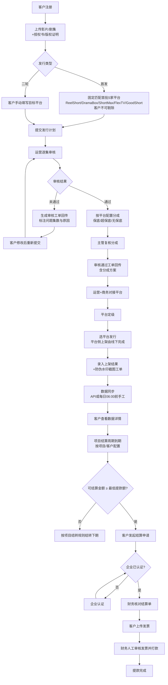
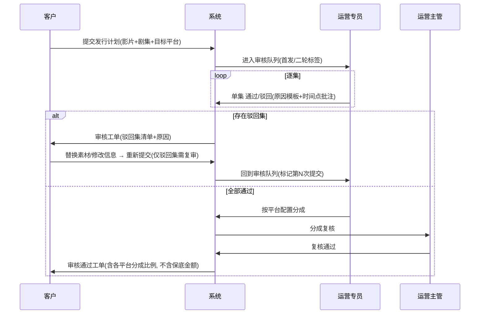
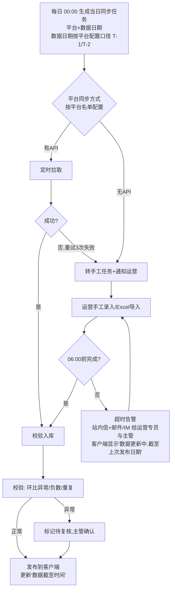
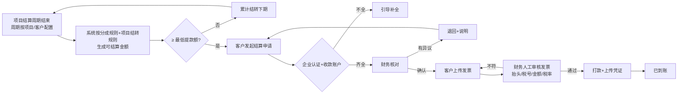
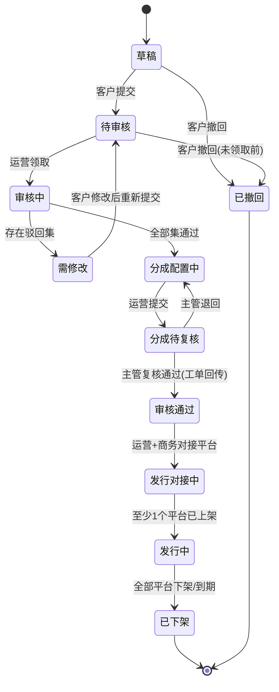
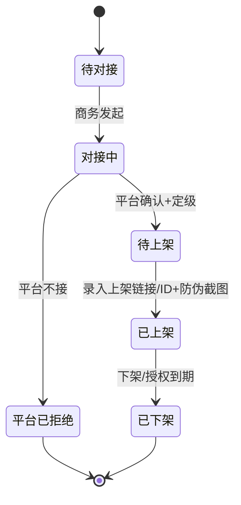
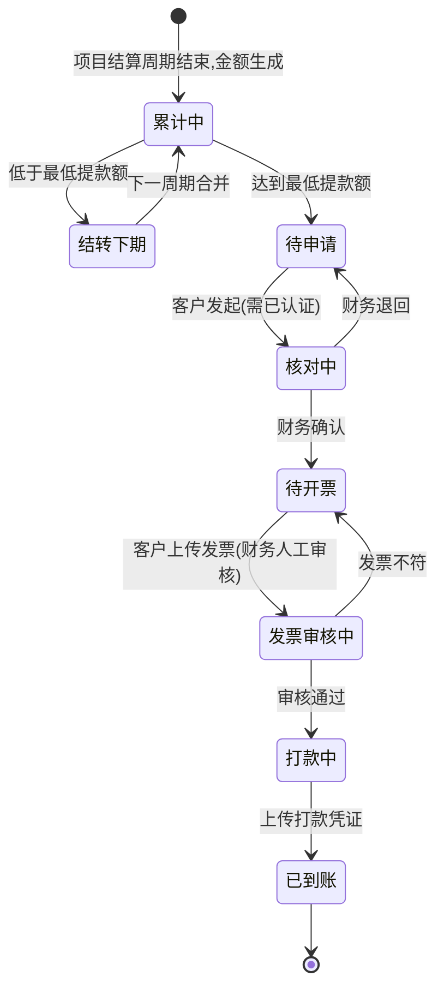

# 短剧海外发行管理平台 PRD（v0.2）

## 版本变更记录

| 版本 | 日期 | 修订人 | 变更内容 |
|---|---|---|---|
| v0.1 | 2026-10-21 | 产品 | 按 2026-10-21 业务口径出初稿（原文首误标为 v1.0）：角色权限、三端信息架构、流程图、状态机、功能清单、可优化点、待确认清单 |
| v0.2 | 2026-10-21 | 产品 | 业务拍板 4 项并同步改流程/状态机/功能/页面：①首批5家定为 ReelShort/DramaBox/ShortMax/FlexTV/GoodShort，首发客户不可剔除；平台名单由我方运营后台配置（新增「平台名单配置」）②保底金额对客户不可见；跨期结转规则按项目单独配置 ③结算周期按项目/客户配置（不固定）；最低提款额后台配置；发票人工审核 ④同步数据日期口径（T-1/T-2）由运营按平台配置。其余待定项标为「暂按默认」；全部 mermaid 经 mermaid-cli 校验 |

> 标记说明：**【已定】** = 业务已拍板；**【暂按默认】** = 业务未单独确认，沿用 v0.1 默认假设开发，如有变更走需求变更；**【待定】** = 仍需拍板后才能开发（见第 10 章）。

---

## 0. 一句话定位与边界

**定位**：服务短剧版权方（客户）的海外发行"申请—审核—分成—数据—结算"一站式管理平台。

**做什么（范围内）**
1. 发行前内容管理：影片/剧集上传、素材与版权文件管理、发行计划申请。
2. 申请流转：剧集审核、分成配置、工单回传、修改重提、平台定级与选平台。
3. 数据同步展示：各海外平台播放量/收益等表现数据的接口同步或人工同步，并在客户端展示。
4. 结算与提款：按结算周期发起结算、企业认证、发票上传、提款。
5. 防伪留证：带时间戳防伪水印截图，以工单形式供客户查看。

**不做什么（范围外）**
- ❌ 不负责向海外平台推送/分发内容（上架动作由运营+商务线下或在各平台后台完成，本平台只记录结果）。
- ❌ 不做视频转码/字幕翻译生产（只存储与管理成品素材）。
- ❌ 不做与海外平台之间的资金清算（只管理我方与客户之间的结算）。

---

## 1. 角色与权限

### 1.1 角色定义

| 端 | 角色 | 职责 |
|---|---|---|
| 用户端 | **客户主账号**（企业管理员） | 注册、企业绑定/认证、收款账户、上传影片、发起发行计划、合同申请、看数据、结算提款、管理子账号 |
| 用户端 | **客户子账号**（可选，后续版本） | 由主账号分配：内容上传员 / 数据查看员 / 财务（结算提款） |
| 运营端 | **运营专员** | 审核剧集、配置分成、出审核工单、每日数据同步（手工录入/导入）、出防伪截图工单 |
| 运营端 | **运营主管** | 运营专员全部权限 + 分成配置复核、超时告警接收、数据修正审批、工单改派 |
| 运营端 | **商务（BD）** | 对接海外平台、平台定级、选定发行平台、维护平台库与平台联系人、录入平台上架结果 |
| 运营端 | **财务** | 审核企业认证资料（可与运营共管）、核对结算单、审核发票、确认打款 |
| 管理端 | **超级管理员** | 账号与角色权限、平台库/首批5家默认平台配置、结算周期、数据同步规则、字典、操作日志 |

### 1.2 权限矩阵（✅可操作 👁只读 —无权限）

| 功能/资源 | 客户主账号 | 运营专员 | 运营主管 | 商务 | 财务 | 超管 |
|---|---|---|---|---|---|---|
| 注册/企业绑定/认证提交 | ✅ | 👁 | 👁 | — | ✅审核 | 👁 |
| 收款账户 | ✅ | — | 👁 | — | 👁 | 👁 |
| 授权书/版权证明上传 | ✅ | 👁审核 | 👁审核 | 👁 | — | 👁 |
| 视频存储库（本企业） | ✅ | 👁全量 | 👁全量 | 👁全量 | — | 👁 |
| 发起发行计划（首发/二轮） | ✅ | — | — | — | — | — |
| 剧集审核（通过/驳回） | — | ✅ | ✅ | 👁 | — | 👁 |
| 分成比例配置（保底/超保底/无保底） | 👁比例（不含保底金额） | ✅提交 | ✅复核 | 👁 | 👁 | 👁 |
| 审核工单 | 👁+回复 | ✅ | ✅ | 👁 | — | 👁 |
| 平台定级/选平台发行/上架结果录入 | 👁结果 | ✅协同 | ✅ | ✅ | — | 👁 |
| 合同申请/合同列表 | ✅申请 | ✅处理 | ✅ | ✅ | 👁 | 👁 |
| 数据同步（手工录入/导入） | — | ✅ | ✅+修正审批 | 👁 | 👁 | ✅规则 |
| 数据详情（本企业） | 👁 | 👁全量 | 👁全量 | 👁全量 | 👁全量 | 👁 |
| 防伪截图工单 | 👁 | ✅生成 | ✅ | ✅生成 | — | 👁 |
| 结算申请/发票/提款 | ✅ | 👁 | 👁 | — | ✅审核打款 | 👁 |
| 平台名单配置（含首批5家） | — | ✅ | ✅ | 👁（平台库信息✅） | — | ✅ |
| 平台同步日期口径（T-1/T-2） | — | ✅ | ✅ | 👁 | 👁 | 👁 |
| 项目结算配置（结算周期、跨期结转规则） | — | 👁 | ✅ | 👁 | ✅ | 👁 |
| 最低提款额（全局） | — | — | 👁 | — | 👁 | ✅ |
| 账号角色 | — | — | — | — | — | ✅ |
| 操作日志 | — | — | 👁 | — | — | ✅ |

**数据隔离原则**：客户只能看到本企业数据；平台对客户可展示的字段由超管配置。**保底金额及保底相关字段对客户一律不可见【已定】**（客户只看到分成比例、分成后收益与结算金额）；平台对我方的结算价同样不对客户展示【暂按默认】。

---

## 2. 三端信息架构

> 三端 = **用户端（客户 Web）**、**运营端（运营/商务/财务工作台）**、**管理端（超管配置后台）**【暂按默认】。运营端与管理端可同一套后台按角色区分菜单。

### 2.1 用户端（一级菜单固定 3 个）

```
用户端
├── 数据详情                         ← 一级菜单 1
│   ├── 数据总览（总播放量/总收益/在发剧集数/发行平台数，数据截至时间）
│   ├── 剧集数据（按剧集 × 平台 × 日期：播放量、完播率、收益等；趋势图；导出）
│   ├── 平台数据（按平台汇总对比）
│   └── 结算与提款
│       ├── 可结算周期列表 → 发起结算申请
│       ├── 结算单详情（各平台分成后金额、结转金额；不展示保底金额）
│       ├── 上传发票（财务人工审核）→ 提款（≥ 最低提款额）
│       └── 提款记录
├── 视频存储库                       ← 一级菜单 2
│   ├── 影片列表（状态筛选：草稿/审核中/需修改/已通过/发行中/已下架）
│   ├── 上传影片（影片信息 + 剧集批量上传 + 封面/海报/预告 + 字幕 + 授权书/版权证明）
│   ├── 影片详情
│   │   ├── 剧集列表（逐集审核状态）
│   │   ├── 发行计划（首发：固定首批5家，不可剔除；二轮：手填目标平台）
│   │   ├── 各平台发行状态
│   │   └── 相关工单（审核结果 / 防伪截图）
│   └── 发起发行计划（入口也可在影片列表行操作）
├── 合同申请及列表                   ← 一级菜单 3
│   ├── 合同列表（发行合同/补充协议；状态：申请中/起草中/待签署/已生效/已到期）
│   ├── 发起合同申请（关联影片 + 发行计划 + 分成方案）
│   └── 合同详情（分成条款、保底条款、附件下载、签署记录）
│
└── 配套（非一级菜单：右上角头像/账户中心 + 关键流程中拦截引导）
    ├── 企业绑定与认证（营业执照、法人、对公信息）
    ├── 收款账户（对公账户，需与认证主体一致）
    ├── 授权书 / 版权证明（企业级资质库，上传影片时可复用）
    ├── 工单中心（审核结果工单、防伪截图工单、数据异议工单）——右上角铃铛
    └── 子账号管理（后续）
```

**拦截引导规则**
- 未企业认证：可上传影片、可看数据；**不可发起合同申请、不可提款**（提示去认证）。
- 未上传授权书/版权证明：不可发起发行计划。
- 未绑定收款账户：不可提交提款。

### 2.2 运营端

```
运营端
├── 工作台（待审核剧集数、待配分成、今日数据同步进度/倒计时、超时告警、待处理工单）
├── 客户管理（客户列表、企业认证审核、资质文件审核）
├── 内容审核
│   ├── 发行计划队列（首发 / 二轮 标签）
│   ├── 剧集逐集审核（预览播放、打点批注、通过/驳回+原因模板）
│   └── 分成配置（按平台：保底 / 超保底 / 无保底；主管复核）
├── 发行管理（运营+商务）
│   ├── 平台定级（剧集定级 S/A/B/C【暂按默认】）
│   ├── 选平台发行（勾选平台、记录对接人、上架时间、上架链接/ID）
│   └── 平台发行状态看板（剧集 × 平台）
├── 平台名单配置（运营维护【已定】：平台启停、首批5家名单与排序、同步方式 API/手工、数据日期口径 T-1/T-2）
├── 平台库（商务维护：平台信息、地区、等级、接口能力、联系人）
├── 数据同步
│   ├── 同步任务看板（按平台：API 自动 / 手工；数据日期按平台口径 T-1/T-2；今日状态、截止 06:00 倒计时）
│   ├── 手工录入页（按 平台 × 日期 × 剧集 表格录入）
│   ├── Excel 导入（模板下载、校验预览、错误行定位、确认入库）
│   ├── 数据修正（修改已发布数据需填原因，主管审批，留痕）
│   └── 接口调研登记（每个平台的接口情况/对接进度）
├── 工单中心（审核结果工单、防伪截图工单、数据异议工单）
│   └── 防伪截图（水印相机模式：截图/拍摄 → 自动加时间戳水印 → 关联工单）
├── 合同管理（处理客户合同申请、上传合同文本、签署状态）
└── 结算管理（财务 / 运营主管）
    ├── 项目结算配置（结算周期、跨期结转规则；客户级默认 + 项目级覆盖）
    ├── 结算单生成/核对
    ├── 发票人工审核（抬头/税号/金额/税率/票面信息逐项核对）
    └── 打款确认（上传打款凭证）
```

### 2.3 管理端

```
管理端
├── 账号与角色权限（RBAC，菜单级 + 按钮级 + 数据级）
├── 分成规则模板（保底/超保底/无保底默认值）
├── 结算全局参数（最低提款额【已定：后台配置】、结算周期/结转规则的默认模板）
├── 数据同步规则（截止时间 06:00、提醒时间点、提醒对象、指标字典）
├── 水印模板（时间戳格式、操作人、工单号、平台名、哈希）
├── 字典与审核原因模板
└── 操作日志 / 登录日志
```

---

## 3. 核心流程图（mermaid）

### 3.1 端到端主流程



### 3.2 剧集审核与工单回传（泳道）



### 3.3 每日数据同步与超时提醒



提醒节奏（默认，可在管理端配置）：**05:00 预警**（未完成任务提醒责任运营）→ **06:00 超时**（升级运营主管，任务标红）→ **每 30 分钟**重复提醒直至完成。

### 3.4 结算提款



---

## 4. 状态机

### 4.1 发行计划（影片级）



### 4.2 单集审核状态

`待审核 → 审核中 → 通过 / 驳回`；`驳回 → 已修改待复审 → 审核中`。已通过的集在重提时**不重复审核**（除非客户替换了该集素材）。

### 4.3 平台发行（剧集 × 平台）



### 4.4 分成配置（剧集 × 平台）

| 模式 | 必填字段（运营端） | 客户端可见 | 说明 |
|---|---|---|---|
| 保底 | 保底金额、币种、保底期、客户分成比例 | 模式标签、分成比例 | 平台给保底，期内收益不超过保底按保底结 |
| 超保底 | 保底金额、保底内比例、**超出部分**客户分成比例 | 模式标签、各段分成比例 | 超过保底部分按另一比例分 |
| 无保底 | 客户分成比例 | 模式标签、分成比例 | 纯按收益分成 |

- **保底金额对客户不可见【已定】**：客户端页面、导出、工单、合同申请列表、接口返回均不得含保底金额字段（接口层脱敏，不只是前端隐藏）。
- **跨期结转规则按项目单独配置【已定】**：在「项目结算配置」中选择，可选项：①保底按期摊销 ②保底累计冲抵（未冲抵完结转下期）③不结转（每期独立结算）。可结算金额不足最低提款额时自动结转下期。规则变更仅对未生成的结算单生效，变更留痕。
- 「项目」口径：一个客户 × 一部影片 × 一个发行轮次（首发/二轮）对应的发行合作；客户级配置为默认值，项目级可覆盖【暂按默认】。

### 4.5 工单

`已创建 → 待客户查看 → 客户已读 → (客户回复/异议 → 处理中 → 已解决) → 已关闭`
工单类型：审核结果、防伪截图、数据异议、结算异议。

### 4.6 每日同步任务

任务的数据日期 = 当天 − 平台口径（T-1/T-2，按平台配置）。`待同步 → 同步中 → 已完成 → 已发布`；`同步中/待同步 → 已超时(06:00) → 已完成(超时完成，留记录)`；`已发布 → 修正中 → 已发布(新版本)`。

### 4.7 企业认证

`未认证 → 审核中 → 已认证 / 认证驳回 → 审核中`；主体变更 → `变更审核中`（审核期间保留原认证，冻结提款）。

### 4.8 结算单



---

## 5. 功能清单与优先级

> MVP 目标：跑通"注册→上传→发行计划→审核工单→分成→选平台→手工数据同步→看数据→结算提款"闭环。

### 5.1 用户端

| 模块 | 功能 | MVP | 后续 |
|---|---|---|---|
| 账户 | 手机/邮箱注册登录 | ✅ P0 | 第三方登录 |
| 账户 | 企业绑定与认证（执照/法人/对公） | ✅ P0 | OCR 自动识别、工商核验接口 |
| 账户 | 收款账户（与认证主体一致校验） | ✅ P0 | 多币种/海外账户 |
| 账户 | 授权书/版权证明上传（企业资质库，可复用） | ✅ P0 | 到期提醒、链上存证 |
| 账户 | 子账号与角色（暂按默认：不进 MVP） | — | ✅ P1 |
| 视频存储库 | 影片信息+剧集批量上传（断点续传/分片） | ✅ P0 | 自动质检（分辨率、黑帧、时长） |
| 视频存储库 | 封面/海报/预告/字幕素材管理 | ✅ P0 | 多语种字幕版本管理 |
| 视频存储库 | 发起发行计划：首发固定首批5家（ReelShort / DramaBox / ShortMax / FlexTV / GoodShort，只读、不可剔除，名单取自运营端平台名单配置） | ✅ P0 | — |
| 视频存储库 | 发起发行计划：二轮手填目标平台（平台库下拉+自由填写） | ✅ P0 | — |
| 视频存储库 | 逐集审核状态、驳回集修改重提 | ✅ P0 | — |
| 视频存储库 | 各平台发行状态查看 | ✅ P0 | — |
| 合同 | 合同申请、合同列表、详情与附件下载（线下签署后上传扫描件【暂按默认】） | ✅ P0 | 在线电子签 |
| 数据详情 | 总览+剧集×平台×日数据+趋势+数据截至时间（按平台口径标注 T-1/T-2；指标暂按默认：播放量、完播率、解锁/订阅、收益） | ✅ P0 | 自定义报表、订阅日报邮件 |
| 数据详情 | 数据导出 Excel | ✅ P1 | — |
| 结算 | 结算申请、结算单明细（不含保底金额，显示结转金额）、发票上传、提款记录；低于最低提款额禁止提交 | ✅ P0 | 自动对账、电子发票验真辅助（审核仍为人工） |
| 工单 | 审核结果/防伪截图工单查看与回复 | ✅ P0 | 数据异议工单 P1 |
| 通知 | 站内信 | ✅ P0 | 邮件/短信/IM |

### 5.2 运营端

| 模块 | 功能 | MVP | 后续 |
|---|---|---|---|
| 工作台 | 待办聚合+同步倒计时+超时告警 | ✅ P0 | 人效统计 |
| 客户 | 企业认证审核、资质审核 | ✅ P0 | — |
| 审核 | 发行计划队列、逐集审核、驳回原因模板 | ✅ P0 | 时间点批注 P1、AI 预审 |
| 审核 | 审核结果工单自动生成回传 | ✅ P0 | — |
| 分成 | 按平台配置保底/超保底/无保底 + 主管复核 | ✅ P0 | 分成模板、批量套用 P1 |
| 发行 | 平台定级、选平台、录入上架结果 | ✅ P0 | — |
| 发行 | 剧集×平台状态看板 | ✅ P1 | — |
| 平台名单配置 | **新增**：平台增删/启停、首批5家名单维护（默认 ReelShort / DramaBox / ShortMax / FlexTV / GoodShort）、同步方式、变更留痕 | ✅ P0 | 名单变更影响面预览 |
| 平台名单配置 | 按平台配置同步数据日期口径 T-1/T-2 | ✅ P0 | 按平台配置时区 |
| 平台库 | 平台信息、地区、等级、联系人、接口能力登记 | ✅ P0 | — |
| 数据同步 | 手工录入页 | ✅ P0 | — |
| 数据同步 | Excel 导入（模板/校验/错误定位） | ✅ P0 | 平台原始报表直接解析 |
| 数据同步 | 05:00 预警 / 06:00 超时提醒与升级 | ✅ P0 | IM 机器人提醒 |
| 数据同步 | 数据修正审批+版本留痕 | ✅ P1 | — |
| 数据同步 | API 自动同步（按调研结果逐平台接入） | — | ✅ P1 |
| 防伪 | 水印相机模式截图+工单 | ✅ P0 | 哈希存证/第三方时间戳 P2 |
| 合同 | 合同申请处理、上传合同、状态 | ✅ P0 | 电子签 |
| 结算 | 项目结算配置：结算周期（按项目/客户）、跨期结转规则（按项目） | ✅ P0 | 配置模板 |
| 结算 | 结算单生成核对、发票人工审核、打款确认 | ✅ P0 | 银企直连自动打款 |

### 5.3 管理端

| 功能 | MVP | 后续 |
|---|---|---|
| RBAC 账号角色（菜单+按钮+数据权限） | ✅ P0 | — |
| 最低提款额配置；结算周期/结转规则默认模板 | ✅ P0 | — |
| 同步截止时间、提醒节点配置 | ✅ P0 | — |
| 水印模板、原因模板、字典 | ✅ P1 | — |
| 操作日志 | ✅ P0 | 审计报表 |

---

## 6. 关键页面要点

### 6.1 手工录入/导入页（运营端）
- 顶部：平台选择、数据日期（按该平台配置的口径 T-1/T-2 自动带出，可手改补录历史日期）、该平台今日任务状态与 **距 06:00 倒计时**。
- 录入表格：行=该平台在发剧集（自动带出），列=指标（播放量、完播率、新增订阅/解锁、收入、币种…，指标字典按平台可配）。支持复制粘贴整块。
- 导入：下载模板（预填剧集ID与平台剧集ID）→ 上传 → 校验预览（必填、类型、负数、环比 ±300% 异常提示、重复）→ 错误行可就地修改 → 确认入库。
- 每次提交记录 操作人、时间、来源（手工/导入/API）、**附原始报表截图/文件**（可直接走水印相机）。

### 6.2 防伪水印截图（水印相机模式）
- 入口：运营端工单内"拍摄/截图取证"，支持上传截图或网页内截屏。
- **服务端**叠加水印（客户端不可伪造）：UTC+8 时间戳【暂按默认】（精确到秒，取服务器时间）、操作人、工单号、平台名、剧集名、图片 SHA-256 短哈希；平铺半透明暗纹 + 角标明文。
- 原图与水印图同时存档，原图仅运营可见；水印图通过工单推送客户。
- 用途：上架证明、平台后台数据证明、下架证明。

### 6.3 发行计划发起（用户端）
- 首发：固定匹配首批5家平台（ReelShort / DramaBox / ShortMax / FlexTV / GoodShort），只读展示，**客户不可剔除**【已定】；名单实时读取运营端「平台名单配置」，提交时快照保存到发行计划。
- 二轮：必须手动填写目标平台（从平台库选择，库中没有的可自由填写，提交后由商务补录平台库）；需说明已发行平台以避免冲突。

### 6.4 平台名单配置（运营端，新增）【已定】
- 列表字段：平台名称、地区、状态（启用/停用）、是否首批（首批标记+排序）、同步方式（API/手工）、**数据日期口径（T-1/T-2）**、责任运营、更新人/时间。
- 首批名单初始化：ReelShort / DramaBox / ShortMax / FlexTV / GoodShort。增删首批平台需运营主管确认；只影响之后新提交的首发计划，已提交计划按提交时快照。
- 停用平台：不能被新计划选择；已上架记录与历史数据保留。
- 口径修改：仅影响次日起生成的同步任务，变更留痕。

### 6.5 项目结算配置（运营端，新增）【已定】
- 配置层级：客户级默认 → 项目级覆盖。
- 字段：结算周期（自然月/季度/自定义天数/自定义起止日，不固定）、首个周期起始日、跨期结转规则（摊销/累计冲抵/不结转）、生效日期、备注。
- 最低提款额读取管理端全局配置（客户端在提款页提示「满 X 元可提」）。
- 保存后生成配置版本；只对未生成的结算单生效。

### 6.6 发票人工审核（运营端·财务）【已定】
- 左侧发票图片/PDF 预览，右侧结算单信息；逐项核对清单：抬头=认证主体、税号、金额=结算金额、税率、开票日期、票面清晰。
- 结果：通过 / 驳回（原因模板 + 备注），驳回通过工单通知客户重传。

---

## 7. 数据同步调研计划（前置任务）

| 步骤 | 内容 | 产出 |
|---|---|---|
| 1 | 首批5家平台（ReelShort / DramaBox / ShortMax / FlexTV / GoodShort）逐一确认：是否有开放 API / 合作方数据后台 / 定期报表邮件 | 平台接口能力表（平台库字段） |
| 2 | 指标口径对齐：播放量定义、收入币种、时区、数据延迟 → 结果由运营在平台名单配置中设定 T-1/T-2 | 指标字典 + 平台口径配置 |
| 3 | 有 API：评估鉴权、频率限制、历史回补 | 接入排期（后续版本） |
| 4 | 无 API：确定手工来源（平台后台导出/截图），定模板 | 手工同步 SOP + 导入模板 |

上线策略：**MVP 全部按手工同步上线**，接口逐平台替换，不阻塞主流程。

---

## 8. 非功能要点
- 视频存储：对象存储 + 分片上传；单文件 ≤ 10GB【暂按默认】；预览用低码率代理文件。
- 安全：素材下载签名 URL + 有效期；客户数据隔离；敏感操作（分成、打款、数据修正）全量日志。
- 时间：所有截止/水印时间统一 UTC+8【暂按默认】；海外平台数据日期按平台时区换算后标注。
- 金额：多币种原值+折算人民币，汇率取值规则【待定】（MVP 先只按平台原币种展示与结算，不做折算）。

---

## 9. 可优化点（每条：对我方价值 / 对客户价值）

| # | 优化点 | 对我方的价值 | 对客户的价值 |
|---|---|---|---|
| 1 | **上传即自动质检**（分辨率、时长、黑帧、字幕缺失、集数连续性） | 运营审核工时下降，驳回往返减少 | 提交前就发现问题，缩短上线等待 |
| 2 | **驳回原因结构化模板 + 时间点批注** | 审核口径统一，新运营上手快，可统计高频问题 | 一眼看懂哪集哪秒要改，改一次过 |
| 3 | **仅复审驳回集** | 重复审核量大幅减少 | 修改后通过更快 |
| 4 | **分成方案模板+批量套用** | 配置效率高、减少错配风险 | 分成条款一致透明，减少合同扯皮 |
| 5 | **Excel 导入模板预填剧集ID + 环比异常校验** | 06:00 前完成率提升，录错可提前拦截 | 数据更准、更新更及时 |
| 6 | **"数据截至时间"与更新中提示** | 降低客户催问与客服压力 | 清楚数据新鲜度，不误判表现 |
| 7 | **逐平台替换为 API 同步** | 释放每日手工人力，消除超时风险 | 数据更实时，可更早决策二轮发行 |
| 8 | **服务端防伪水印 + 原图哈希存证** | 争议时有可靠证据，降低纠纷与法律风险 | 对上架/数据真实性放心，增强信任 |
| 9 | **平台表现对比 + 二轮发行推荐** | 提升二轮发行转化，增加分成收入 | 用数据选平台，提升收益 |
| 10 | **结算前自动对账、发票信息预填与校验** | 财务核对与退票次数减少 | 开票一次通过，回款更快 |
| 11 | **资质到期提醒（授权书/版权证明）** | 规避授权过期仍在发行的合规风险 | 提前续约，不中断收益 |
| 12 | **子账号分权（上传/数据/财务）** | 对接人清晰，减少账号共用带来的安全问题 | 团队协作方便，权责分离 |
| 13 | **订阅日报/周报邮件** | 提高客户活跃与续约意愿 | 不登录也能掌握表现 |
| 14 | **在线电子签** | 合同周期缩短、归档规范 | 免邮寄，签约更快 |

---

## 10. 口径确认状态

### 10.1 已拍板【已定】（v0.2）
| # | 事项 | 结论 |
|---|---|---|
| 1 | 首批5家平台 | ReelShort / DramaBox / ShortMax / FlexTV / GoodShort；首发客户不可剔除；名单由我方运营在「平台名单配置」维护 |
| 2 | 保底可见性 / 跨期结转 | 保底金额对客户不可见（接口层脱敏）；跨期结转规则按项目单独配置 |
| 3 | 结算 | 结算周期不固定，按项目/客户配置；最低提款额后台配置；发票人工审核 |
| 4 | 数据日期口径 | T-1/T-2 由运营按平台配置 |

### 10.2 暂按默认（沿用 v0.1 假设，可开发，变更走需求变更）
| # | 事项 | 默认口径 |
|---|---|---|
| 1 | 三端划分 | 用户端（客户）/ 运营端（运营·商务·财务）/ 管理端（超管） |
| 2 | 平台定级 | S/A/B/C 四级，由运营+商务人工评定 |
| 3 | 时区 | 截止时间、水印、系统时间统一 UTC+8；平台数据日期按 T-1/T-2 口径标注 |
| 4 | 合同形式 | 线下签署、上传扫描件；一份发行计划对应一份合同申请；电子签放后续 |
| 5 | 客户子账号 | 不进 MVP（P1） |
| 6 | 数据指标 | 播放量、完播率、解锁/订阅、收益（原币种），按平台可配 |
| 7 | 「项目」定义 | 客户 × 影片 × 发行轮次；客户级默认、项目级覆盖 |
| 8 | 单文件上限 | 10GB |
| 9 | 平台结算价可见性 | 不对客户展示 |

### 10.3 剩余待定【待定】
1. 汇率与币种折算规则（MVP 先按原币种，不折算）。
2. 结转规则三个选项的具体计算公式（需财务给 1~2 个示例算例）。
3. 定级 S/A/B/C 的评定标准与是否影响分成比例默认值。
