# 短剧海外发行管理平台 PRD（v0.5）

## 版本变更记录

| 版本 | 日期 | 修订人 | 变更内容 |
|---|---|---|---|
| v0.1 | 2026-10-21 | 产品 | 按 2026-10-21 业务口径出初稿（原文首误标为 v1.0）：角色权限、三端信息架构、流程图、状态机、功能清单、可优化点、待确认清单 |
| v0.2 | 2026-10-21 | 产品 | 业务拍板 4 项并同步改流程/状态机/功能/页面：①首批5家定为 ReelShort/DramaBox/ShortMax/FlexTV/GoodShort，首发客户不可剔除；平台名单由我方运营后台配置（新增「平台名单配置」）②保底金额对客户不可见；跨期结转规则按项目单独配置 ③结算周期按项目/客户配置（不固定）；最低提款额后台配置；发票人工审核 ④同步数据日期口径（T-1/T-2）由运营按平台配置。其余待定项标为「暂按默认」；全部 mermaid 经 mermaid-cli 校验 |
| v0.3 | 2026-10-21 | 产品 | 业务再拍板 2 项：①结算统一人民币：平台原币种收入按汇率换算为人民币结算；汇率取值方式（来源、取值日期、固定/浮动、舍入）为运营端配置项，配置变更与每笔换算所用汇率全程留痕可追溯；客户端展示人民币结算金额并附原币种参考；新增「汇率配置」页、汇率记录库与换算快照字段，结算流程/状态机增加换算与「汇率待补」②S/A/B/C 定级暂不做、移出 MVP：从主流程、平台发行状态机、功能清单、权限矩阵、信息架构中删除定级步骤，列入「后续版本」。剩余待定仅「结转公式算例」；mermaid 经 mermaid-cli 重新校验 |
| v0.4 | 2026-10-21 | 产品 | 业务再拍板 2 项：①**结算金额改为运营手工录入**：删除三种跨期结转方式（摊销/累计冲抵/不结转）、项目级结转配置及「结转公式算例」待定项；新增「应结金额录入」（人民币应结金额+备注+留痕：录入人/录入时间/每次修改前后值）与复核（财务或运营主管）；保底、分成比例、平台收入、汇率参考换算仅作录入参考展示，不参与系统计算；结算单状态机改为 待录入→待复核→待申请/未达起提额→…，去掉「汇率待补/累计中/结转下期」；最低提款额校验保留，不足额按「保留并可与后续结算单合并申请」处理【暂按默认】；汇率与手工录入冲突时以录入金额为准【暂按默认】②汇率配置「全局默认可按客户/项目覆盖」「客户结算单可见汇率/日期/来源」两条改为【已定】。mermaid 经 mermaid-cli 校验 |
| v0.5 | 2026-10-21 | 产品 | **规模化改造**：按「数百客户、单客户数百部剧、平台总量数千部剧/数十万集」重审全流程。新增 0.1 规模假设；客户端补批量上传（文件夹上传、元数据 Excel 导入与文件自动匹配、分片直传与断点续传、上传队列）、批量发行申请、剧集搜索/多维筛选/标签/分组/服务端分页/保存视图；运营端补审核队列与分派（按人/按客户）、抽检策略替代逐集全审、批量通过/驳回、SLA 与超时提醒、分成模板与批量套用、平台报表一键导入（字段映射模板、剧名精确+模糊匹配确认、别名库、异常行在线修正）替代逐条手填、结算单批量生成/Excel 导入/批量复核（留痕规则不变）、水印截图批量上传自动归档（文件名规则，失败进待归档）、全列表导出（大量走异步）；新增异步任务中心、批量操作幂等与部分失败处理、索引与性能指标建议（非功能章重写）。同步改流程图（新增 3.5/3.6）、状态机（新增上传文件、导入批次、水印归档、异步任务）、权限矩阵、菜单、功能清单、页面说明；结算单粒度调整为「客户 × 结算周期」。新增**第 6 章「用户端设计原则（用户端优先）」**：14 条原则（封面墙为主可切表格、状态颜色/图标/进度条、拖拽上传、一键大按钮+向导、图表+一句话结论、首次引导与空状态、少字段智能默认、操作可撤销、批量=封面墙多选+底部浮动操作条、筛选=状态卡片+快捷标签、分组可视化、说人话、进度透明、就地修复）逐条给出 Ant Design 组件建议，配客户视角状态映射与页面验收清单，并落实到用户端页面说明（7.3/7.9/7.10/7.15/7.16/7.17）与功能清单；原第 6~10 章顺延为第 7~11 章，非功能为第 9 章。新增口径均标【暂按默认】。mermaid 经 mermaid-cli 校验 |

> 标记说明：**【已定】** = 业务已拍板；**【暂按默认】** = 业务未单独确认，沿用 v0.1 默认假设或按最简合理方式处理，如有变更走需求变更；**【待定】** = 仍需拍板后才能开发（见第 11 章）。

---

## 0. 一句话定位与边界

**定位**：服务短剧版权方（客户）的海外发行"申请—审核—分成—数据—结算"一站式管理平台。

**做什么（范围内）**
1. 发行前内容管理：影片/剧集上传、素材与版权文件管理、发行计划申请。
2. 申请流转：剧集审核、分成配置、工单回传、修改重提、选平台。
3. 数据同步展示：各海外平台播放量/收益等表现数据的接口同步或人工同步，并在客户端展示。
4. 结算与提款：按结算周期发起结算、企业认证、发票上传、提款。
5. 防伪留证：带时间戳防伪水印截图，以工单形式供客户查看。

**不做什么（范围外）**
- ❌ 不负责向海外平台推送/分发内容（上架动作由运营+商务线下或在各平台后台完成，本平台只记录结果）。
- ❌ 不做视频转码/字幕翻译生产（只存储与管理成品素材）。
- ❌ 不做与海外平台之间的资金清算（只管理我方与客户之间的结算）。

### 0.1 规模假设与设计原则（v0.5 新增）【暂按默认】

| 维度 | 假设量级 | 对设计的影响 |
|---|---|---|
| 客户数 | 数百（按 500 设计，预留到 2,000） | 运营须按客户分派，专员默认只看负责客户；客户端全部列表服务端分页 |
| 单客户剧量 | 数百部（按 500 部/客户设计） | 客户端必须批量上传、批量发行、搜索/筛选/标签/分组/保存视图 |
| 平台总剧量 | 数千部（按 1 万部设计） | 审核不可能逐集全审 → 抽检策略 + 队列分派 + SLA |
| 平台总集数 | 数十万集（按 100 万集设计；均 60~100 集/部） | 集级不做人工逐条操作；素材上传、技术校验、归档全部批量/异步 |
| 素材体量 | 单集 50MB~2GB，单部 10~50GB，总量百 TB 级 | 对象存储分片直传，不经应用服务器；冷热分层 |
| 发行平台 | 首批 5 家 + 二轮若干（按 30 家设计） | 平台报表导入按平台保存字段映射模板 |
| 每日同步数据 | 剧×平台×日：数万行/日；年累计千万级 | 一键导入 + 自动匹配；数据表按日期分区 |
| 结算单 | 每周期数百张（客户 × 周期），明细数万行 | 批量生成、Excel 批量录入、批量复核 |
| 同时在线 | 客户 ≤ 500、运营 ≤ 100 | 见第 9 章性能指标 |

**设计原则**
1. **一切可批量**：凡是"按剧/按集/按行"的操作，都提供多选批量、按筛选结果全选、Excel 导入三种入口之一。
2. **一切长耗时走异步**：上传校验、导入、导出、批量审核/复核/套用、结算批量生成，统一进入「任务中心」，有进度、有结果报告、可重试失败项。
3. **部分成功是常态**：批量操作按条处理、按条出结果，不因少数失败整体回滚（结算金额相关除外，见 9.4）。
4. **机器先过、人工兜底**：技术校验、剧名匹配、截图归档先自动，失败才进人工队列。
5. **留痕规则不因批量而放松**：批量录入/修改/复核逐条记录操作人、时间、前后值、来源批次号。

---

## 1. 角色与权限

### 1.1 角色定义

| 端 | 角色 | 职责 |
|---|---|---|
| 用户端 | **客户主账号**（企业管理员） | 注册、企业绑定/认证、收款账户、批量上传影片、批量发起发行申请、合同申请、看数据、结算提款、管理标签/分组/视图、管理子账号 |
| 用户端 | **客户子账号**（可选，后续版本） | 由主账号分配：内容上传员 / 数据查看员 / 财务（结算提款） |
| 运营端 | **运营专员** | 处理分派给自己的审核队列（抽检审核、批量通过/驳回）、分成模板套用、平台报表导入与匹配确认、结算金额录入/Excel 导入、水印截图批量上传与待归档处理；默认只看**负责客户**与自己队列的数据【暂按默认】 |
| 运营端 | **运营主管** | 运营专员全部权限（全量客户）+ 分派规则/抽检策略/SLA 看板、改派、分成批量复核、数据修正审批、超时升级接收、应结金额复核 |
| 运营端 | **商务（BD）** | 对接海外平台、选定发行平台、维护平台库与联系人、批量录入上架结果、上传上架证明截图 |
| 运营端 | **财务** | 企业认证审核、应结金额（批量）复核、提款核对、发票人工审核、打款确认 |
| 管理端 | **超级管理员** | 账号与角色权限、SLA 与提醒规则、导出阈值、全局任务监控、数据同步规则、字典、操作日志 |

### 1.2 权限矩阵（✅可操作 👁只读 —无权限）

> 「负责客户」= 分派给该专员的客户；专员对非负责客户无可见性，主管/财务/超管为全量【暂按默认】。所有导出都按本人数据权限过滤，并对客户端导出执行保底脱敏。

| 功能/资源 | 客户主账号 | 运营专员 | 运营主管 | 商务 | 财务 | 超管 |
|---|---|---|---|---|---|---|
| 注册/企业绑定/认证提交 | ✅ | 👁负责客户 | 👁 | — | ✅审核 | 👁 |
| 收款账户 | ✅ | — | 👁 | — | 👁 | 👁 |
| 授权书/版权证明上传 | ✅ | 👁审核 | 👁审核 | 👁 | — | 👁 |
| 视频存储库（批量上传/元数据导入/标签/分组/视图） | ✅本企业 | 👁负责客户 | 👁全量 | 👁全量 | — | 👁 |
| 发起发行申请（单部/批量；首发/二轮） | ✅ | — | — | — | — | — |
| 审核队列：领取/处理（抽检、批量通过/驳回） | — | ✅本人队列 | ✅ | 👁 | — | 👁 |
| 审核分派规则、改派 | — | — | ✅ | — | — | 👁 |
| 抽检策略配置 | — | 👁 | ✅ | — | — | 👁 |
| SLA 看板 / 超时提醒接收 | 👁本企业申请进度 | ✅本人 | ✅全量 | ✅本人 | ✅本人 | ✅配置 |
| 分成模板维护 | — | 👁 | ✅ | 👁 | 👁 | 👁 |
| 分成配置/模板批量套用（仅作结算录入参考） | 👁比例（不含保底金额） | ✅提交 | ✅批量复核 | 👁 | 👁 | 👁 |
| 审核工单 | 👁+回复 | ✅ | ✅ | 👁 | — | 👁 |
| 选平台发行/上架结果（批量）录入 | 👁结果 | ✅协同 | ✅ | ✅ | — | 👁 |
| 合同申请/合同列表 | ✅申请 | ✅处理 | ✅ | ✅ | 👁 | 👁 |
| 平台报表导入、字段映射模板 | — | ✅ | ✅ | 👁 | 👁 | ✅规则 |
| 剧名匹配确认 / 别名库维护 | — | ✅ | ✅ | 👁 | — | 👁 |
| 已发布数据修正 | — | ✅提交 | ✅审批 | — | — | 👁 |
| 数据详情 | 👁本企业 | 👁负责客户 | 👁全量 | 👁全量 | 👁全量 | 👁 |
| 水印截图（单张/批量上传、待归档处理） | 👁（工单内） | ✅ | ✅ | ✅ | — | 👁 |
| 结算申请/发票/提款 | ✅ | 👁 | 👁 | — | ✅审核打款 | 👁 |
| 平台名单配置（含首批5家） | — | ✅ | ✅ | 👁（平台库信息✅） | — | ✅ |
| 平台同步日期口径（T-1/T-2） | — | ✅ | ✅ | 👁 | 👁 | 👁 |
| 结算周期配置（按项目/客户） | — | 👁 | ✅ | 👁 | ✅ | 👁 |
| 结算单批量生成（手动触发/重跑） | — | — | ✅ | — | ✅ | 👁 |
| 应结金额录入/修改（单条/Excel 批量，全程留痕） | 👁复核后金额 | ✅负责客户 | ✅ | — | 👁 | 👁 |
| 应结金额复核（单条/批量；录入人≠复核人） | — | — | ✅ | — | ✅ | 👁 |
| 最低提款额（全局） | — | — | 👁 | — | 👁 | ✅ |
| 汇率配置（取值方式、汇率录入/复核、变更与参考换算留痕） | 👁结算单参考汇率/日期/来源 | 👁 | ✅ | — | ✅ | 👁 |
| 导出（同步/异步） | ✅本企业 | ✅权限内 | ✅ | ✅权限内 | ✅权限内 | ✅ |
| 任务中心 | 👁本人任务 | 👁本人任务 | 👁全团队 | 👁本人任务 | 👁本人任务 | 👁全局+取消 |
| 账号角色 | — | — | — | — | — | ✅ |
| 操作日志 | — | — | 👁 | — | — | ✅ |

**数据隔离原则**：客户只能看到本企业数据；平台对客户可展示的字段由超管配置。**保底金额及保底相关字段对客户一律不可见【已定】**（客户只看到分成比例、分成后收益与结算金额）；平台对我方的结算价同样不对客户展示【暂按默认】。

---

## 2. 三端信息架构

> 三端 = **用户端（客户 Web）**、**运营端（运营/商务/财务工作台）**、**管理端（超管配置后台）**【暂按默认】。运营端与管理端可同一套后台按角色区分菜单。
> v0.5 通用约定：所有列表 = 服务端分页（20/50/100）+ 多维筛选 + 排序 + 列自定义 + 保存视图 + 多选/按筛选结果全选 + 导出；右上角常驻「上传队列」与「任务中心」入口。

### 2.1 用户端（一级菜单固定 3 个）

```
用户端
├── 数据详情                         ← 一级菜单 1
│   ├── 数据总览（总播放量/总收益[人民币预估，以结算单为准]/在发剧集数/发行平台数，数据截至时间；Top/Bottom 剧榜）
│   ├── 剧集数据（剧 × 平台 × 日期：播放量、完播率、收益等；按剧名/标签/分组/平台/日期范围筛选；服务端分页；趋势图；导出）
│   ├── 平台数据（按平台汇总对比）
│   └── 结算与提款
│       ├── 可结算单列表（客户 × 周期；可多张合并）→ 发起结算申请
│       ├── 结算单详情（以运营录入并复核的人民币应结金额为准；明细按剧×平台分页；附原币收入、参考汇率/日期/来源及对客户说明；不展示保底金额与分成计算过程）
│       ├── 上传发票（财务人工审核）→ 提款（所选结算单合计 ≥ 最低提款额）
│       └── 提款记录
├── 视频存储库                       ← 一级菜单 2
│   ├── 剧集列表（v0.5 重做；默认封面墙，可切表格；顶部状态卡片+快捷标签；多选后底部浮动操作条，见第 6 章）
│   │   ├── 搜索：剧名 / 外文名 / 剧 ID / 平台剧 ID
│   │   ├── 多维筛选：审核状态、发行轮次、目标平台、上架状态、题材/类型、语言、集数区间、上传时间、标签、分组、是否有驳回/待处理工单、素材完整度
│   │   ├── 标签（客户自定义，多标签）、分组（一部剧可属多个分组）
│   │   ├── 服务端分页 + 排序 + 列自定义 + 保存视图（个人视图，可设默认）
│   │   └── 批量操作：发起发行申请、打标签、加入分组、导出、下载审核意见
│   ├── 批量上传（v0.5 新增）
│   │   ├── 文件夹上传（按「剧名/集号.mp4」目录结构自动识别）
│   │   ├── 元数据 Excel 批量导入（模板下载 → 导入 → 与文件自动匹配 → 匹配结果确认）
│   │   └── 上传队列（分片直传、断点续传、暂停/继续/重试、并发控制）
│   ├── 剧详情
│   │   ├── 基本信息 / 素材（封面、海报、预告、字幕）/ 资质（授权书、版权证明）
│   │   ├── 剧集列表（集号、文件校验状态、抽检结果；服务端分页）
│   │   ├── 发行计划（首发：固定首批5家，不可剔除；二轮：手填目标平台）
│   │   ├── 各平台发行状态
│   │   └── 相关工单（审核结果 / 防伪截图）
│   └── 批量发行申请（入口：剧集列表多选 / 按筛选结果全选）
├── 合同申请及列表                   ← 一级菜单 3
│   ├── 合同列表（发行合同/补充协议；状态：申请中/起草中/待签署/已生效/已到期；搜索/筛选/分页）
│   ├── 发起合同申请（关联影片（可多部）+ 发行计划 + 分成方案）
│   └── 合同详情（分成条款、保底条款[客户可见部分]、附件下载、签署记录）
│
└── 配套（非一级菜单：右上角 + 账户中心 + 关键流程中拦截引导）
    ├── 上传队列（右上角，全局常驻）
    ├── 任务中心（右上角：元数据导入、批量发行、导出等异步任务进度与结果报告）
    ├── 企业绑定与认证（营业执照、法人、对公信息）
    ├── 收款账户（对公账户，需与认证主体一致）
    ├── 授权书 / 版权证明（企业级资质库，可一份授权覆盖多部剧，批量关联）
    ├── 标签与分组管理
    ├── 工单中心（审核结果、防伪截图、数据异议；按剧/类型/状态筛选，批量标记已读）——右上角铃铛
    └── 子账号管理（后续）
```

**拦截引导规则**
- 未企业认证：可上传影片、可看数据；**不可发起合同申请、不可提款**（提示去认证）。
- 未关联授权书/版权证明的剧：不可发起发行申请（批量申请时该剧在预检中被跳过并给出原因）。
- 未绑定收款账户：不可提交提款。

### 2.2 运营端

```
运营端
├── 工作台（我的待办：待审核/待分成/待匹配确认/待归档/待录入/待复核；SLA 即将超时与已超时；今日数据同步进度/06:00 倒计时；我发起的任务）
├── 客户管理（客户列表[搜索/筛选/分页]、责任运营分配、企业认证审核、资质文件审核）
├── 内容审核
│   ├── 审核队列（我的队列 / 团队队列；按客户/平台/首发二轮/提交时间/SLA 剩余时长筛选排序；批量通过/驳回）
│   ├── 剧审核工作台（抽检集列表、预览播放、打点批注、扩大抽检/转全审、通过/驳回+原因模板）
│   ├── 分派规则（按客户归属 / 按负载均衡 / 手动改派；人员容量上限）——主管
│   ├── 抽检策略（规则配置与命中预览）——主管
│   └── SLA 看板（按环节、按人、按客户的在途量与超时量）——主管
├── 分成管理
│   ├── 分成模板（平台 × 模式 × 比例；版本化）——主管维护
│   ├── 批量套用（选剧 → 选模板 → 差异预览 → 提交）
│   └── 分成复核（单条/批量）
├── 发行管理（运营+商务）
│   ├── 选平台发行（单部/批量）
│   ├── 上架结果批量录入（Excel：剧 ID、平台、平台剧 ID、上架时间、链接）
│   └── 平台发行状态看板（剧 × 平台，服务端分页）
├── 平台名单配置（运营维护【已定】：平台启停、首批5家名单与排序、同步方式 API/手工、数据日期口径 T-1/T-2）
├── 平台库（商务维护：平台信息、地区、接口能力、联系人）
├── 数据同步
│   ├── 同步任务看板（平台 × 数据日期：API / 报表导入；状态、06:00 倒计时）
│   ├── 平台报表导入（一键导入平台原始 Excel/CSV → 自动套用字段映射模板 → 剧名匹配 → 异常行在线修正 → 发布）
│   ├── 字段映射模板（按平台保存、版本化）
│   ├── 剧名匹配确认 / 别名库（平台剧名·平台剧 ID ↔ 我方剧 ID）
│   ├── 单条补录（少量修补，非主路径）
│   ├── 数据修正（已发布数据修改需原因，主管审批，留痕）
│   └── 接口调研登记
├── 防伪截图
│   ├── 单张取证（水印相机模式）
│   ├── 批量上传（按文件名规则自动归档到 剧 × 日期）
│   └── 待归档（匹配失败的截图人工指定归属）
├── 工单中心（审核结果、防伪截图、数据异议、结算异议；搜索/筛选/批量处理）
├── 合同管理（处理客户合同申请、上传合同文本、签署状态）
├── 结算管理（财务 / 运营主管）
│   ├── 结算周期配置（客户级默认 + 项目级覆盖）
│   ├── 结算单批量生成（周期结束自动 + 手动触发/重跑）
│   ├── 应结金额录入（单条：参考面板 + 录入；批量：Excel 模板下载 → 填写 → 导入预览 → 确认）
│   ├── 应结金额复核（单条 / 批量；录入人≠复核人）
│   ├── 汇率配置（取值方式、汇率记录库、版本与变更日志、参考换算追溯）
│   ├── 提款申请核对
│   ├── 发票人工审核
│   └── 打款确认（上传打款凭证）
└── 任务中心（本人/团队异步任务：导入、导出、批量操作、批量生成的进度与结果报告、失败项重试）
```

### 2.3 管理端

```
管理端
├── 账号与角色权限（RBAC，菜单级 + 按钮级 + 数据级[负责客户/全量]）
├── 分成规则模板默认值（保底/超保底/无保底）
├── 结算全局参数（最低提款额【已定：后台配置】、结算周期默认模板、应结偏差提示阈值）
├── 数据同步规则（截止时间 06:00、提醒时间点、提醒对象、指标字典、模糊匹配阈值）
├── SLA 与提醒规则（各环节时限、提醒节点、升级对象、工作日历）
├── 导出与任务参数（同步导出行数上限、文件保留天数、单任务并发、批量操作单次上限）
├── 文件命名规则（水印截图归档规则、文件夹上传集号识别规则）
├── 水印模板（时间戳格式、操作人、工单号、平台名、哈希）
├── 字典与审核原因模板
├── 全局任务监控（所有异步任务、队列积压、失败率；可取消）
└── 操作日志 / 登录日志
```

---

## 3. 核心流程图（mermaid）

### 3.1 端到端主流程（规模化版）

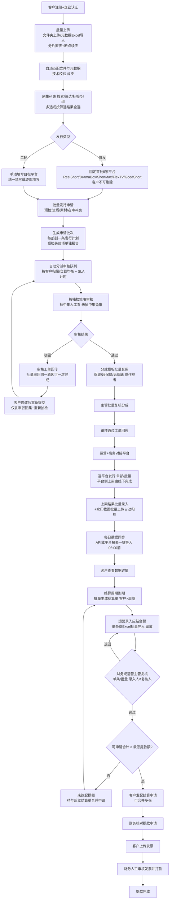

### 3.2 批量发行申请、分派与抽检审核（泳道）

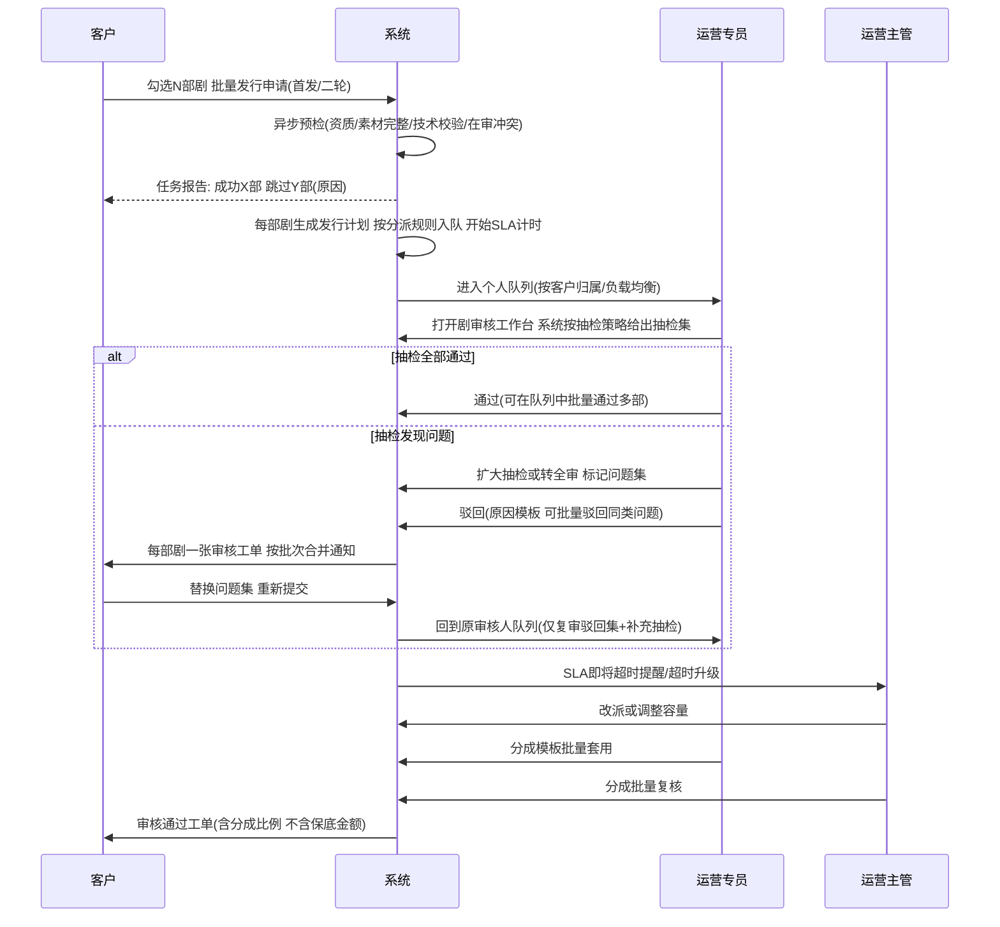

### 3.3 每日数据同步：平台报表一键导入（替代逐条手填）

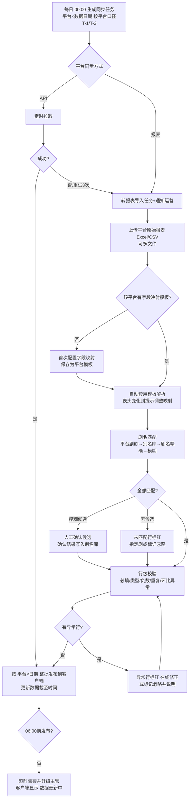

提醒节奏（默认，可在管理端配置）：**05:00 预警** → **06:00 超时**（升级运营主管，任务标红）→ **每 30 分钟**重复提醒直至发布。主管可在异常行未处理完时「排除异常行后强制发布」，被排除行留在待修正区，修正后作为补充版本发布并留痕【暂按默认】。

### 3.4 结算：批量生成 → 批量录入 → 批量复核 → 提款

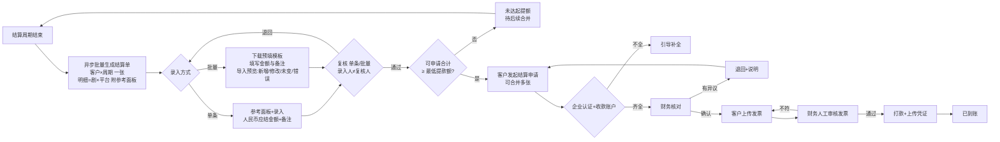

留痕规则不变：每条结算单/明细的录入、修改、复核逐条记录操作人、时间、修改前后值、原因；批量来源额外记录**导入批次号/任务 ID**。

### 3.5 客户批量上传与元数据匹配（v0.5 新增）

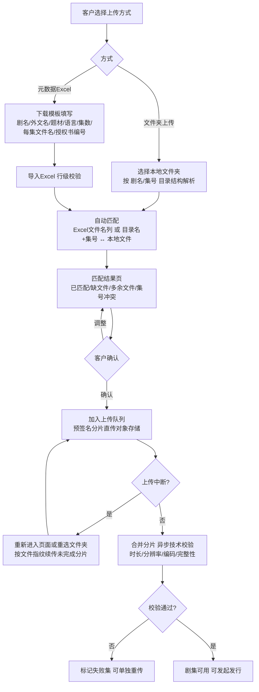

### 3.6 水印截图批量上传与自动归档（v0.5 新增）

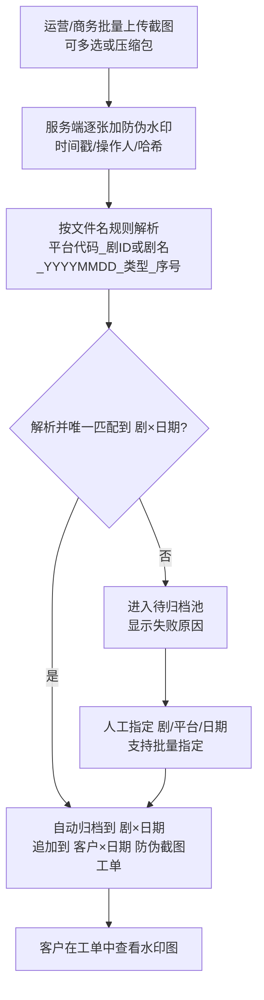

---

## 4. 状态机

### 4.1 发行计划（剧级；批量申请时每部剧一条，按批次号关联）

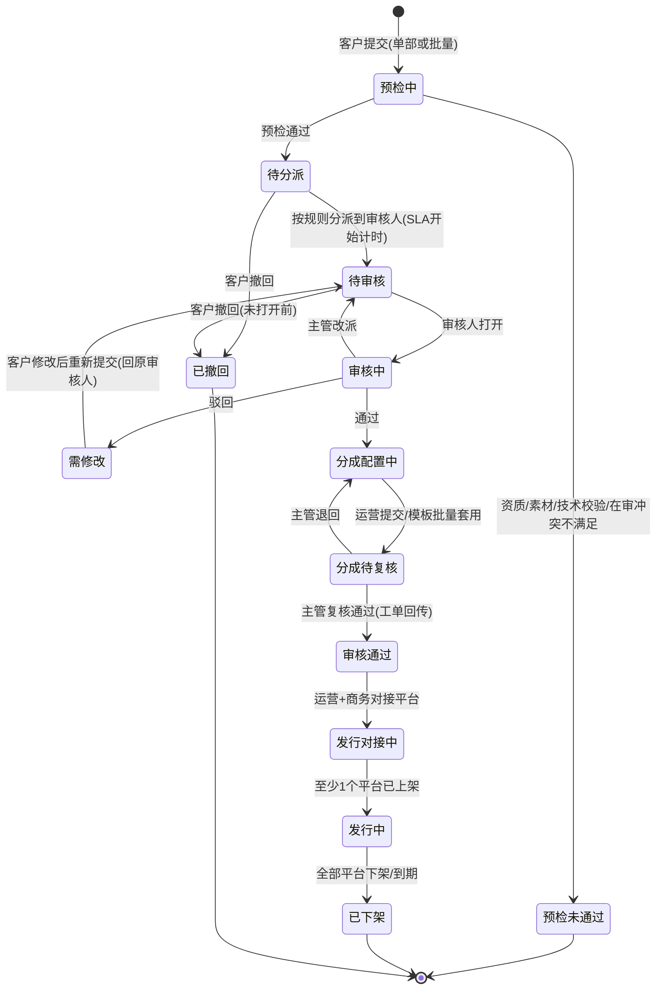

- 批量申请不设「批次整体状态」，批次只做聚合展示（总数/各状态数量/SLA 超时数）【暂按默认】。
- 「预检未通过」不生成审核任务，原因写入任务报告，客户修正后可重新申请。

### 4.2 剧审核与单集抽检（v0.5 改为抽检制）

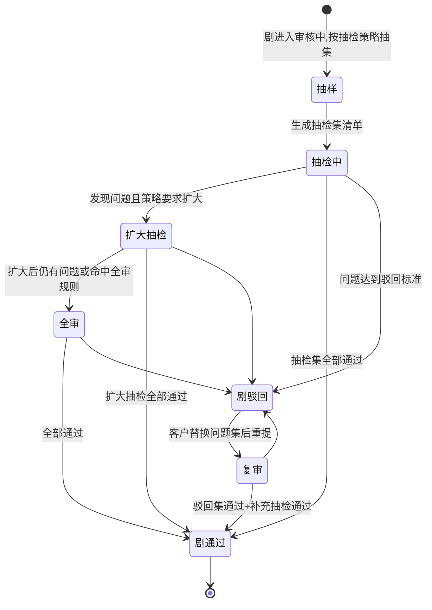

- 单集状态：`未抽中(免审)` / `待审` / `通过` / `问题` / `已替换待复审`。未抽中集随剧通过，审核记录中标注「抽检免审」。
- 已通过的集在重提时不重复审核，除非素材文件指纹变化。

### 4.3 平台发行（剧集 × 平台）

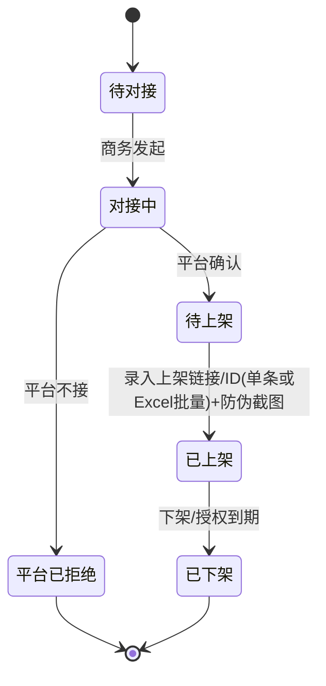

### 4.4 分成配置（剧集 × 平台）

| 模式 | 必填字段（运营端） | 客户端可见 | 说明 |
|---|---|---|---|
| 保底 | 保底金额、币种、保底期、客户分成比例 | 模式标签、分成比例 | 平台给保底，期内收益不超过保底按保底结 |
| 超保底 | 保底金额、保底内比例、**超出部分**客户分成比例 | 模式标签、各段分成比例 | 超过保底部分按另一比例分 |
| 无保底 | 客户分成比例 | 模式标签、分成比例 | 纯按收益分成 |

- **保底金额对客户不可见【已定】**：客户端页面、导出、工单、合同申请列表、接口返回均不得含保底金额字段（接口层脱敏，不只是前端隐藏）。
- **分成配置仅作参考，不参与系统计算【已定】**：保底金额、保底期、各段分成比例在「应结金额录入」页作为参考信息展示给运营；系统不计算应结金额、不做保底摊销/冲抵/结转，应结金额由运营手工录入（见 7.8）。
- 保底金额按合同原币种记录，仅运营端可见。
- 「项目」口径：一个客户 × 一部影片 × 一个发行轮次（首发/二轮）对应的发行合作；结算周期、汇率配置均为客户级默认、项目级可覆盖【暂按默认】。

### 4.5 工单

`已创建 → 待客户查看 → 客户已读 → (客户回复/异议 → 处理中 → 已解决) → 已关闭`
工单类型：审核结果、防伪截图、数据异议、结算异议（客户对应结金额有异议时发起，运营修改金额须重新复核）。

规模化规则【暂按默认】：
- 审核结果工单：**每部剧一张**；同一批次的工单产生的站内信/邮件**按批次合并为一条通知**。
- 防伪截图工单：**每客户每日一张**，当日该客户所有归档截图追加进同一工单，避免工单爆量。
- 工单列表支持按剧、类型、状态、时间筛选，批量标记已读/关闭。

### 4.6 每日同步任务与报表导入批次

同步任务（平台 × 数据日期）：数据日期 = 当天 − 平台口径（T-1/T-2，按平台配置）。`待同步 → 同步中 → 已发布`；`待同步/同步中 → 已超时(06:00) → 已发布(超时发布，留记录)`；`已发布 → 修正中 → 已发布(新版本)`。

一个同步任务可包含多个**导入批次**（多文件/补充导入）：

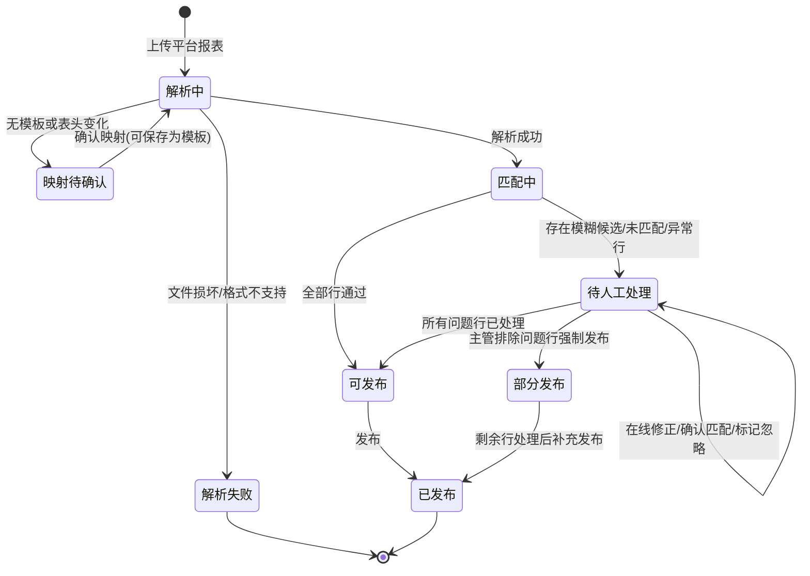

- 同一 `平台 + 数据日期 + 文件哈希` 重复导入时提示「已导入过」，需确认才继续（幂等，见 9.4）。
- 数据写入按唯一键 `平台 + 数据日期 + 剧 ID` 覆盖更新，旧值进入版本历史。

### 4.7 企业认证

`未认证 → 审核中 → 已认证 / 认证驳回 → 审核中`；主体变更 → `变更审核中`（审核期间保留原认证，冻结提款）。

### 4.8 结算单

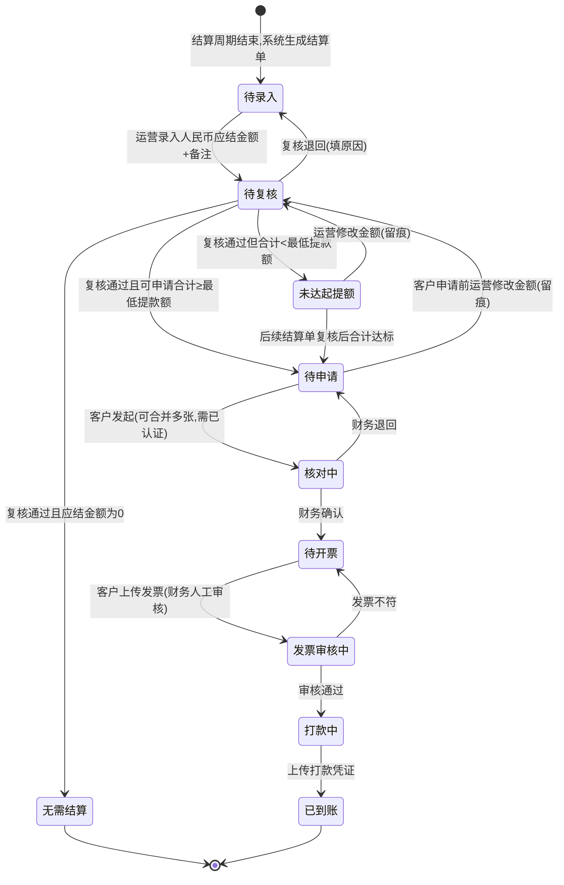

- 说明：应结金额为 0 的结算单复核通过后归档为「无需结算」【暂按默认】。
- 粒度（v0.5）：结算单 = **客户 × 结算周期**（同一截止日的项目合并为一张），明细行 = 剧 × 平台【暂按默认】；周期不同的项目分属不同结算单。
- 批量操作（批量录入/批量复核/批量退回）对每张结算单独立执行状态迁移并逐条留痕；某张失败不影响其他张。
- 「核对中」起金额锁定；之后如需改金额，须财务退回到「待申请」，运营修改后重新复核，全程留痕。

### 4.9 汇率配置与参考换算【已定】

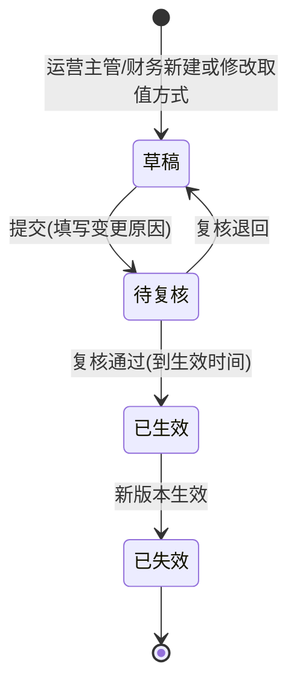

- 汇率配置以**版本**管理，每个版本不可修改，只能新建版本替代；变更日志记录 变更人、时间、变更前后值、原因、复核人。
- 结算单生成及运营录入时，系统按生效配置为每一行原币收入生成**参考换算快照**（见 7.7），供运营录入参考与客户对账参考；**最终以运营录入并复核的人民币应结金额为准**，参考换算与录入金额不一致时不阻断流程，仅提示差额【暂按默认】。结算单进入「核对中」后快照与金额一并锁定。
- 缺少所需汇率时，参考面板提示「缺少汇率，参考换算不可用」，不阻断录入【暂按默认】。

### 4.10 上传文件（单个视频/素材文件）

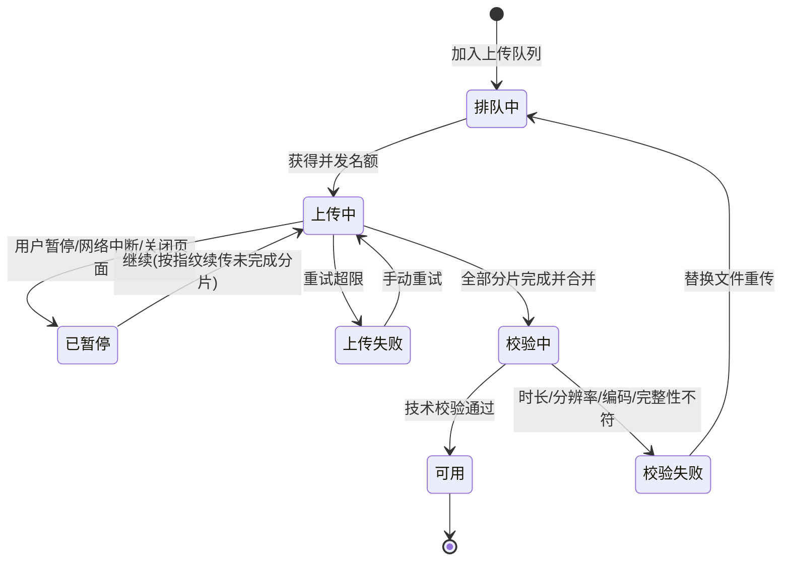

- 未完成的分片上传会话保留 7 天【暂按默认】，超期自动清理。

### 4.11 水印截图归档

`已上传 → 加水印中 → 解析中 → 已归档` / `解析中 → 待归档 → (人工指定) → 已归档`；`已归档 → 已改归属`（改归属留痕，原工单记录保留）。

### 4.12 异步任务（导入/导出/批量操作/批量生成通用）

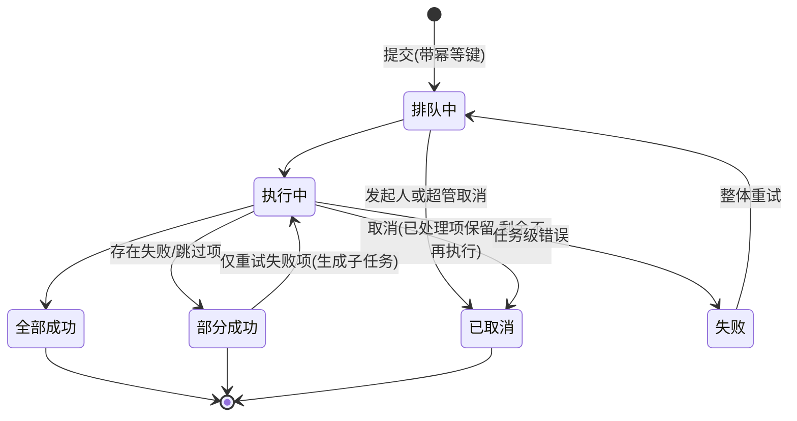

---

## 5. 功能清单与优先级

> MVP 目标（v0.5）：在**数百客户 × 数百部剧/客户**规模下跑通"注册→批量上传→批量发行申请→分派+抽检审核→分成模板套用→选平台→报表一键导入→看数据→结算批量生成/录入/复核→提款"闭环。判断原则：**没有它在目标规模下无法日常运转的，进 MVP**。

### 5.1 用户端

| 模块 | 功能 | MVP | 后续 |
|---|---|---|---|
| 账户 | 手机/邮箱注册登录 | ✅ P0 | 第三方登录 |
| 账户 | 企业绑定与认证（3 步向导，见 7.15） | ✅ P0 | OCR 自动识别、工商核验接口 |
| 账户 | 收款账户（人民币对公账户，与认证主体一致校验） | ✅ P0 | 海外/外币账户 |
| 账户 | 授权书/版权证明上传（企业资质库；一份授权批量关联多部剧） | ✅ P0 | 到期提醒、链上存证 |
| 账户 | 子账号与角色（暂按默认：不进 MVP） | — | ✅ P1 |
| 批量上传 | **拖拽/文件夹上传**（大拖拽区，见 7.9）：按「剧名/集号.ext」目录结构解析，集号识别规则可配 | ✅ P0 | 桌面上传工具（超大批量/弱网） |
| 批量上传 | **元数据 Excel 批量导入**：模板下载、行级校验、与文件自动匹配（文件名列 / 目录+集号）、匹配结果确认页（已匹配/缺文件/多余/冲突） | ✅ P0 | 从客户已有片单系统 API 导入 |
| 批量上传 | **分片直传对象存储 + 断点续传**（按文件指纹续传，会话保留 7 天） | ✅ P0 | — |
| 批量上传 | **上传队列**：全局常驻、并发控制、暂停/继续/重试、失败集单独重传、整体进度 | ✅ P0 | 限速/定时上传 |
| 批量上传 | 上传后异步技术校验（时长/分辨率/编码/完整性/集数连续性） | ✅ P0 | 黑帧/静音/字幕缺失等深度质检 |
| 视频存储库 | 封面/海报/预告/字幕素材管理（支持批量导入） | ✅ P0 | 多语种字幕版本管理 |
| 视频存储库 | **剧集列表**（默认封面墙，可切表格，见 7.10）：剧名/外文名/ID 搜索；状态卡片+快捷标签+抽屉多维筛选；服务端分页/排序；列自定义 | ✅ P0 | 全文检索（简介/演员） |
| 视频存储库 | **标签与分组**：自定义标签（多标签）、分组（一部剧可属多组）、批量打标签/入组 | ✅ P0 | 智能标签 |
| 视频存储库 | **保存视图**（筛选+排序+列，个人视图、可设默认） | ✅ P1 | 团队共享视图 |
| 发行 | 首发固定首批5家（ReelShort / DramaBox / ShortMax / FlexTV / GoodShort，只读、不可剔除，名单取自运营端平台名单配置） | ✅ P0 | — |
| 发行 | 二轮手填目标平台（平台库下拉+自由填写；批量时可统一填写或逐部填写） | ✅ P0 | — |
| 发行 | **批量发行申请**（4 步向导，见 7.3）：封面墙多选/按筛选结果全选（单次上限 200 部）→ 预检 → 异步提交 → 完成页「成功 X / 需处理 Y」 | ✅ P0 | — |
| 发行 | 审核进度：按剧查看状态/驳回集/审核意见；批量下载审核意见 | ✅ P0 | — |
| 发行 | 驳回集替换重提（单部/批量） | ✅ P0 | — |
| 合同 | 合同申请（可关联多部剧）、列表、详情与附件下载（线下签署后上传扫描件【暂按默认】） | ✅ P0 | 在线电子签 |
| 数据详情 | 大数字卡片+一句话结论+趋势/占比/Top 榜图表（见 7.17）；剧×平台×日明细默认收起；数据截至时间人话显示；按剧名/标签/分组/平台/日期筛选，服务端分页 | ✅ P0 | 自定义报表、订阅日报邮件 |
| 数据详情 | 数据导出 Excel（≤5,000 行同步，超出走异步任务） | ✅ P0 | — |
| 结算 | 一键提款向导（见 7.16）；结算单列表与明细（明细分页；人民币应结金额为准，附原币收入与参考汇率/日期/来源；不含保底金额）、多张合并申请、发票上传、提款记录 | ✅ P0 | 电子发票验真辅助 |
| 工单 | 审核结果/防伪截图工单：筛选、批量已读；批次合并通知 | ✅ P0 | 数据异议工单 P1 |
| 任务中心 | 本人异步任务进度、结果报告下载、失败项重试 | ✅ P0 | — |
| 通知 | 站内信（批次合并） | ✅ P0 | 邮件/短信/IM |
| 体验（第 6 章） | **封面墙/表格切换**（视频存储库、发行进度、Top 榜） | ✅ P0 | — |
| 体验 | **统一状态色板 + 图标 + 进度条**；客户视角 5 态映射 | ✅ P0 | — |
| 体验 | **状态卡片 + 快捷标签筛选**；已选条件可关闭标签 | ✅ P0 | — |
| 体验 | **封面墙多选 + 底部浮动操作条**；选中全部筛选结果 | ✅ P0 | — |
| 体验 | **向导式流程**：发行申请（7.3）、企业认证（7.15）、提款（7.16）、批量上传（7.9） | ✅ P0 | — |
| 体验 | **数据图表 + 一句话结论**（规则生成） | ✅ P0 | 智能洞察（异常波动解读） |
| 体验 | **首次使用引导**（上手清单 + 分步高亮）与**空状态插图** | ✅ P0 | 视频教程 |
| 体验 | **操作可撤销**（10 秒撤销 + 回收站 30 天） | ✅ P0 | — |
| 体验 | 分组栏拖拽归组 | ✅ P1 | — |

### 5.2 运营端

| 模块 | 功能 | MVP | 后续 |
|---|---|---|---|
| 工作台 | 我的待办聚合 + SLA 即将超时/已超时 + 同步倒计时 | ✅ P0 | 人效统计 |
| 客户 | 客户列表（搜索/筛选/分页）、**责任运营分配**、企业认证审核、资质审核 | ✅ P0 | — |
| 审核队列 | **队列与分派**：按客户归属自动分派，无归属按负载均衡；人员容量上限；主管手动/批量改派 | ✅ P0 | 技能标签分派（语种/题材） |
| 审核队列 | 队列筛选排序（客户/平台/首发二轮/提交时间/SLA 剩余） | ✅ P0 | — |
| 审核 | **抽检策略**：可配置规则替代逐集全审（见 7.11）；命中预览 | ✅ P0 | 基于历史驳回率自动调参 |
| 审核 | 剧审核工作台：抽检集清单、预览播放、扩大抽检/转全审、驳回原因模板 | ✅ P0 | 时间点批注 P1、AI 预审 |
| 审核 | **批量通过/批量驳回**（同一原因模板，逐剧生成工单，按批次合并通知） | ✅ P0 | — |
| SLA | **SLA 计时与超时提醒**：各环节时限、80% 预警、超时升级主管；SLA 看板 | ✅ P0 | SLA 报表与考核 |
| 分成 | **分成模板**（平台×模式×比例，版本化）+ **批量套用**（差异预览）+ 主管批量复核 | ✅ P0 | 按客户默认模板自动套用 |
| 发行 | 选平台（单部/批量）、上架结果 Excel 批量录入 | ✅ P0 | — |
| 发行 | 剧×平台状态看板（服务端分页） | ✅ P1 | — |
| 平台名单配置 | 平台增删/启停、首批5家名单维护（默认 ReelShort / DramaBox / ShortMax / FlexTV / GoodShort）、同步方式、数据日期口径 T-1/T-2、变更留痕 | ✅ P0 | 名单变更影响面预览 |
| 平台库 | 平台信息、地区、联系人、接口能力登记 | ✅ P0 | — |
| 数据同步 | **平台报表一键导入**（原始 Excel/CSV，多文件） | ✅ P0 | 邮件附件/SFTP 自动拉取 |
| 数据同步 | **字段映射模板**：按平台保存、版本化；表头变化提示 | ✅ P0 | — |
| 数据同步 | **剧名自动匹配**：平台剧 ID → 别名库 → 剧名精确（归一化）→ 模糊匹配候选人工确认；确认结果沉淀别名库 | ✅ P0 | — |
| 数据同步 | **异常行标红 + 在线修正/标记忽略**；排除问题行强制发布（主管） | ✅ P0 | — |
| 数据同步 | 05:00 预警 / 06:00 超时提醒与升级 | ✅ P0 | IM 机器人提醒 |
| 数据同步 | 单条补录（非主路径） | ✅ P1 | — |
| 数据同步 | 数据修正审批+版本留痕 | ✅ P1 | — |
| 数据同步 | API 自动同步（按调研结果逐平台接入） | — | ✅ P1 |
| 防伪 | 水印相机模式单张取证 | ✅ P0 | 哈希存证/第三方时间戳 P2 |
| 防伪 | **批量上传自动归档**（文件名规则匹配 剧×日期；失败进待归档；待归档批量指定） | ✅ P0 | 图像识别（OCR 剧名/日期）辅助归档 |
| 合同 | 合同申请处理、上传合同、状态 | ✅ P0 | 电子签 |
| 结算 | 结算周期配置（按项目/客户） | ✅ P0 | 配置模板 |
| 结算 | **结算单批量生成**（周期结束自动 + 手动触发/重跑，异步） | ✅ P0 | — |
| 结算 | 应结金额单条录入（参考面板 + 人民币金额 + 内部备注/对客户说明） | ✅ P0 | — |
| 结算 | **应结金额 Excel 批量导入**（预填模板、导入预览：新增/修改/未变/错误；逐条留痕） | ✅ P0 | — |
| 结算 | **批量复核/批量退回**（跳过本人录入项；偏差超阈值项需逐条确认） | ✅ P0 | — |
| 结算 | 修改留痕（录入人/时间/前后值/原因/来源批次号） | ✅ P0 | — |
| 结算 | 提款申请核对、发票人工审核、打款确认 | ✅ P0 | 银企直连自动打款 |
| 汇率 | 汇率配置、汇率记录库（支持 Excel 导入）、参考换算追溯 | ✅ P0 | 对接权威汇率源自动抓取 |
| 导出 | **全列表导出**（权限内；≤5,000 行同步，超出异步） | ✅ P0 | 定时导出 |
| 任务中心 | 本人/团队异步任务、结果报告、失败项重试、取消 | ✅ P0 | — |
| 发行 | 剧集定级 S/A/B/C（v0.3 移出 MVP；评定标准届时再定） | — | ✅ P2 |

### 5.3 管理端

| 功能 | MVP | 后续 |
|---|---|---|
| RBAC 账号角色（菜单+按钮+数据权限：负责客户/全量） | ✅ P0 | — |
| 最低提款额配置；结算周期默认模板；应结偏差提示阈值 | ✅ P0 | — |
| 同步截止时间、提醒节点、模糊匹配阈值 | ✅ P0 | — |
| SLA 与提醒规则、工作日历 | ✅ P0 | — |
| 导出与任务参数（同步导出上限、文件保留天数、批量单次上限、并发） | ✅ P0 | — |
| 文件命名规则（截图归档、集号识别） | ✅ P0 | — |
| 全局任务监控（积压、失败率、取消） | ✅ P1 | 告警接入 |
| 水印模板、原因模板、字典 | ✅ P1 | — |
| 操作日志 | ✅ P0 | 审计报表 |

### 5.4 后续版本（已明确移出 MVP 的事项）
| 事项 | 说明 |
|---|---|
| 剧集定级 S/A/B/C | v0.3 业务拍板暂不做。MVP 流程中「运营+商务对接平台」后直接「选平台发行」；后续版本再引入定级节点、评定标准及其与分成默认值的关联 |
| 客户子账号 | 暂按默认，P1 |
| API 自动同步 | 按接口调研结果逐平台接入，P1 |
| 在线电子签 | 后续 |
| 桌面上传工具 / 对象存储账号直传 | 超大批量或弱网客户使用；MVP 先用浏览器分片直传 |
| 截图 OCR 辅助归档、平台报表自动拉取（邮件/SFTP） | MVP 以文件名规则与人工上传为主 |
| 团队共享视图、SLA 考核报表 | P1/P2 |
| 系统自动计算应结金额（含保底摊销/冲抵/结转） | v0.4 拍板改为运营手工录入，系统不计算；如后续需要自动计算再另行立项 |

---

## 6. 用户端设计原则（用户端优先）（v0.5 新增）

> 客户是做视频的人：习惯看画面、看颜色、拖文件，不习惯读表格和填长表单。**用户端一切设计以"看得懂、点得少、不怕点错"为先**；规模化能力（批量、筛选、分组）必须"长在可视化界面上"，不能以增加学习成本为代价。运营端以效率为先，可表格化。
> 组件基线：Ant Design 5.x（图表用 @ant-design/charts）。下列原则为用户端验收标准，评审时逐条核对。

### 6.1 原则与组件对照

| # | 原则 | 落地做法（用户端） | Ant Design 组件建议 |
|---|---|---|---|
| 1 | **封面墙为主，表格为辅** | 视频存储库、发行进度、数据 Top 榜默认用海报卡片网格（竖版 3:4 封面 + 剧名 + 角标）；右上角一键切换表格视图；视图偏好记住 | `Card`（cover）、`Image`（懒加载/预览）、`Row`/`Col` 或 `List grid`、`Segmented`（封面墙/表格切换）、`Table`（`virtual`） |
| 2 | **状态用颜色 + 图标 + 进度条表达** | 统一状态色板：灰=草稿/未开始、蓝=进行中、橙=需要你处理、绿=完成/已上架、红=失败/被驳回；每个状态配固定图标；多步流程显示进度条/步骤条；文字只做补充 | `Tag`（color + icon）、`Badge`（status/角标 `Badge.Ribbon`）、`Progress`（line/circle）、`Steps`、`Timeline`、`Tooltip`（悬停解释） |
| 3 | **拖拽上传** | 全站上传入口均为大拖拽区，支持拖文件夹；上传中卡片直接显示进度；右下角悬浮上传队列 | `Upload.Dragger`（`directory`、`multiple`、自定义 `customRequest` 分片直传）、`FloatButton`（带 `badge` 的队列入口）、`Drawer` + `List` + `Progress`（上传队列） |
| 4 | **一键式大按钮 + 向导式流程** | 每页只有 1 个主操作大按钮（如「申请发行」「一键提款」「去认证」）；复杂流程拆成 3~4 步向导：发行申请、企业认证、提款、批量上传；完成页明确"下一步做什么" | `Button`（`type="primary" size="large"`）、`Steps` + 分步 `Form`、`Result`（完成页）、`Modal`/全屏 `Drawer`（向导容器） |
| 5 | **数据 = 图表 + 一句话结论** | 先给结论再给图：大数字卡片 + 环比箭头 + 系统生成一句话结论；明细表默认收起 | `Statistic`（含 `prefix` 箭头）、`Card`、@ant-design/charts `Line`/`Column`/`Pie`/`Bar`、`Alert`（type=info 放结论句）、`Collapse`（收起明细） |
| 6 | **首次使用引导 + 空状态插图** | 首次登录"3 步上手"清单（认证 → 上传 → 申请发行），完成度进度条；关键页面首次进入用分步高亮引导；所有空列表用插图 + 一句话 + 主按钮 | `Tour`（分步高亮）、`Steps`/`Progress`（上手清单）、`Empty`（自定义 `image` 插图 + 操作按钮）、`Result` |
| 7 | **少字段、智能默认值** | 表单只露必填（≤ 5 个），其他收进"更多信息"；默认值来自上次填写、文件名/目录解析、企业资料；能识别的不让用户填 | `Form`（`initialValues`）、`Collapse`（更多信息）、`AutoComplete`、`Select`（预选）、`DatePicker`（默认值）、`Input` `allowClear` |
| 8 | **操作可撤销，不怕点错** | 移除、取消选择、打标签、移出分组、撤回申请（未进入审核前）等操作执行后 10 秒内可撤销；删除进入回收站 30 天；只有不可逆操作才二次确认 | `message`/`notification`（带「撤销」按钮）、`Popconfirm`（仅不可逆操作）、`Modal.confirm`（危险操作） |
| 9 | **批量 = 封面墙多选 + 底部浮动操作条** | 卡片悬停出现勾选框，选中即出现底部浮动条「已选 N 部｜申请发行｜打标签｜加入分组｜导出｜取消」；提供「选中全部筛选结果（共 X 部）」；不需要进入任何"批量模式" | `Checkbox`（卡片角标）、`Affix`（`offsetBottom`）+ `Space` + `Button` 组成操作条、`Typography.Link`（全选筛选结果）、`Dropdown`（更多操作） |
| 10 | **筛选 = 状态卡片 + 快捷标签** | 顶部状态卡片带数量，点击即筛选（全部/需要你处理/审核中/已上架/未发行）；一行快捷标签（首发、二轮、各平台 Logo、近 7 天）；高级筛选收在抽屉；已生效条件以可关闭标签展示；常用组合一键"保存为视图"，以页签呈现 | `Card` + `Statistic`（可点击状态卡）、`Tag.CheckableTag`（快捷标签）、`Drawer` + `Form`（更多筛选）、`Tag closable`（已选条件）、`Tabs`（保存的视图）、`Input.Search` |
| 11 | **分组/标签可视化** | 左侧可折叠分组栏（带封面拼贴缩略图与数量），卡片拖进分组即归组；标签彩色、可多选批量打 | `Layout.Sider`（collapsible）、`Menu` 或 `Tree`（分组，支持拖放）、`Tag`（彩色标签）、`Select mode="tags"`、拖拽用 dnd-kit |
| 12 | **说人话，隐藏内部概念** | 客户端不出现内部状态和术语：内部多状态合并为客户视角 5 态（见 6.2）；"T-1"显示为"数据更新到 10 月 20 日"；SLA 显示为"预计 10 月 23 日前完成" | `Typography`、`Tooltip`（悬停解释）、`Descriptions`（详情信息） |
| 13 | **进度透明、可预期** | 每部剧有发行进度时间线（上传 → 审核 → 准备上架 → 已上架）；提款显示到账进度（核对 → 发票审核 → 打款 → 到账） | `Steps`（`size="small"`）、`Timeline`、`Progress` |
| 14 | **反馈即时、错误可就地修复** | 批量结果用 Result + 分组列表展示"成功 X / 需处理 Y"，每条"需处理"直接给「去处理」按钮；表单错误就地提示 | `Result`、`List`、`Alert`、`Form` 校验提示、`Spin`/`Skeleton`（加载） |

### 6.2 客户视角状态映射【暂按默认】

| 客户看到 | 颜色/图标 | 对应内部状态 |
|---|---|---|
| 草稿 | 灰 · 编辑图标 | 草稿、上传中、校验中 |
| 需要你处理 | 橙 · 感叹号 | 需修改（驳回）、预检未通过、校验失败、待补资质 |
| 审核中 | 蓝 · 时钟 + 预计完成时间 | 预检中、待分派、待审核、审核中、分成配置中、分成待复核 |
| 准备上架 | 蓝 · 火箭 | 审核通过、发行对接中、平台待上架 |
| 已上架 | 绿 · 对勾 + 平台 Logo | 发行中（≥1 个平台已上架） |
| 已下架 / 已撤回 | 灰 · 归档 | 已下架、已撤回 |

### 6.3 用户端页面验收清单（每页必须满足）
1. 首屏有且只有 1 个主操作大按钮；
2. 列表默认封面墙（结算单、合同、工单等非视频列表可用卡片列表）并可切表格；
3. 状态有颜色 + 图标，流程有进度；
4. 空状态有插图 + 引导按钮，首次进入有引导；
5. 批量操作通过多选 + 底部浮动操作条完成，无需切换模式；
6. 表单必填 ≤ 5 项，其余有默认值或收起；
7. 可逆操作提供撤销，不可逆操作才二次确认；
8. 不出现内部术语（保底、SLA、T-1、预检、分派等）。

---

## 7. 关键页面要点

### 7.1 平台报表一键导入（运营端，v0.5 替代逐条手填）
- **入口**：同步任务看板某「平台 × 日期」行 →「导入报表」；也可直接拖入多个文件，系统按文件名/表头识别平台。
- **步骤 1 上传**：Excel/CSV，单文件 ≤ 50MB / 20 万行【暂按默认】；记录文件哈希，同平台同日期同哈希重复导入需确认。
- **步骤 2 字段映射**：自动套用该平台最新映射模板（平台列名 → 我方字段：平台剧 ID、剧名、日期、播放量、完播率、解锁/订阅、收入、币种…）；首次或表头变化时进入映射页，拖拽/下拉完成映射，可「保存为平台模板」（版本化，记录修改人）。
- **步骤 3 剧名匹配**（按顺序，命中即止）：①平台剧 ID 在别名库 ②平台剧名在别名库 ③剧名归一化后精确匹配（去空格/标点/大小写、全半角、繁简）④模糊匹配（相似度 ≥ 0.85 给出最多 3 个候选）【暂按默认】。模糊候选需人工点选确认，确认结果写入别名库，下次自动命中；无候选的行标红，可搜索指定剧或「标记忽略+原因」。支持「同名批量确认」。
- **步骤 4 校验与在线修正**：行级校验（必填、类型、负数、重复、环比 ±300% 异常、剧未在该平台上架）；异常行标红并定位到单元格，表格内直接修改；可只看异常行；修正后即时重校验。
- **步骤 5 发布**：按「平台 × 数据日期」整批发布，客户端「数据截至时间」更新；主管可排除问题行强制发布。
- **结果报告**：总行数 / 自动匹配 / 人工确认 / 忽略 / 修正 / 发布行数，可下载；所有导入记录操作人、时间、文件、模板版本。
- 单条补录页保留，仅用于少量修补。

### 7.2 防伪水印截图（单张取证 + 批量归档）
- **单张**：工单内"拍摄/截图取证"，支持上传截图或网页内截屏。
- **服务端**叠加水印（客户端不可伪造）：UTC+8 时间戳【暂按默认】（精确到秒，取服务器时间）、操作人、工单号、平台名、剧集名、图片 SHA-256 短哈希；平铺半透明暗纹 + 角标明文。
- 原图与水印图同时存档，原图仅运营可见；水印图通过工单推送客户。
- **批量上传（v0.5）**：拖入多张或 zip（单次 ≤ 500 张【暂按默认】）；按文件名规则解析：`{平台代码}_{剧ID或剧名}_{YYYYMMDD}_{类型}_{序号}.png`，类型 = 上架/数据/下架【暂按默认，规则在管理端可配】。剧名解析复用别名库与归一化匹配；唯一命中则归档到「剧 × 日期」并追加到「客户 × 日期」防伪截图工单。
- **待归档**：解析失败/多候选/剧不存在的截图进入待归档池，显示原因与缩略图；支持多选后批量指定剧/平台/日期；归档后可改归属（留痕）。
- 用途：上架证明、平台后台数据证明、下架证明。

### 7.3 发行申请向导（用户端，单部/批量统一入口）
- **入口**：封面墙多选后底部浮动操作条「申请发行」大按钮；或剧详情页「申请发行」。
- **向导 4 步**：①确认剧目（已选剧以封面缩略图展示，可移除；单次 ≤ 200 部【暂按默认】）→ ②选择发行类型（两张大卡片：「首发」「二轮」）→ ③目标平台（首发：5 家平台 Logo 卡片只读展示 ReelShort / DramaBox / ShortMax / FlexTV / GoodShort，**不可剔除**【已定】；二轮：平台 Logo 多选卡片 + 「其他平台」输入，默认"统一应用到所有已选剧"，可展开逐部调整）→ ④预检与提交（逐部显示 ✅可提交 / ⚠️需处理：缺授权书、素材校验未通过、已有在审计划，提供「去处理」链接；不影响其他剧提交）。
- 提交后异步处理，完成页（Result）显示"已提交 X 部，Y 部需处理"，可跳转任务报告；首发名单提交时快照保存。
- 二轮库中没有的平台提交后由商务补录平台库。

### 7.4 平台名单配置（运营端，新增）【已定】
- 列表字段：平台名称、地区、状态（启用/停用）、是否首批（首批标记+排序）、同步方式（API/手工）、**数据日期口径（T-1/T-2）**、责任运营、更新人/时间。
- 首批名单初始化：ReelShort / DramaBox / ShortMax / FlexTV / GoodShort。增删首批平台需运营主管确认；只影响之后新提交的首发计划，已提交计划按提交时快照。
- 停用平台：不能被新计划选择；已上架记录与历史数据保留。
- 口径修改：仅影响次日起生成的同步任务，变更留痕。

### 7.5 结算周期配置（运营端）【已定】
- 配置层级：客户级默认 → 项目级覆盖。
- 字段：结算周期（自然月/季度/自定义天数/自定义起止日，不固定）、首个周期起始日、生效日期、备注。（v0.4 起不再配置跨期结转规则）
- 周期结束时系统生成「待录入」结算单并提醒责任运营。
- 最低提款额读取管理端全局配置（客户端在提款页提示「满 X 元可提」）。
- 保存后生成配置版本；只对未生成的结算单生效。

### 7.6 发票人工审核（运营端·财务）【已定】
- 左侧发票图片/PDF 预览，右侧结算单信息；逐项核对清单：抬头=认证主体、税号、金额=结算单人民币金额、税率、开票日期、票面清晰。
- 结果：通过 / 驳回（原因模板 + 备注），驳回通过工单通知客户重传。

### 7.7 汇率配置（运营端·结算管理，新增）【已定】
**A. 取值方式配置（版本化）**
| 字段 | 说明 / 可选值 |
|---|---|
| 配置编号 / 版本号 | 系统生成，版本只增不改 |
| 适用范围 | 全局默认；可按客户/项目覆盖【已定】 |
| 币种对 | 原币种 → CNY（如 USD→CNY、EUR→CNY…），可多行 |
| 汇率来源 | 中国人民银行人民币汇率中间价 / 中国外汇交易中心 / 指定银行牌价（填写银行与买入/卖出/中间价）/ 合同约定 / 手工录入 |
| 汇率类型 | 浮动（按取值日期规则每次取值）/ 固定（填写固定汇率值 + 有效期） |
| 取值日期规则 | 结算周期最后一个自然日 / 最后一个工作日 / 结算单生成日 / 收入数据日期逐日换算 / 周期内日均值 / 指定日期；节假日无汇率时：取前一个有汇率日 |
| 精度与舍入 | 汇率保留位数（默认 4 位）、金额保留 2 位、舍入方式（四舍五入/截断）、换算粒度（逐笔换算后汇总 / 汇总后换算） |
| 生效时间 | 只影响生效后生成的参考换算 |
| 变更原因 / 复核人 | 必填；提交后须另一人复核（运营主管 ↔ 财务互审） |

**B. 汇率记录库**：币种对、汇率日期、汇率值、来源、获取方式（手工/导入/自动）、录入人、录入时间、附件（来源截图，可走水印相机）。已被结算单引用的记录不可修改，只能作废并新增，作废需原因。

**C. 参考换算快照（结算单明细每行写入，仅作参考）**：原币种、原币金额、汇率值、汇率日期、汇率来源、汇率记录 ID、汇率配置版本号、舍入规则、参考人民币金额、换算时间。最终金额以 7.8 运营录入为准【暂按默认】。

**D. 追溯查询**：按结算单 / 客户 / 项目 / 平台 / 剧集 / 汇率记录反查，导出 Excel；配置变更日志展示前后对比。

**E. 客户端展示【已定】**：结算单与提款以**运营录入并复核的人民币应结金额为准**；明细附原币收入及参考汇率值、汇率日期、汇率来源，并注明「参考汇率依据合同及我方汇率配置，结算以应结金额为准」；如运营填写了「对客户说明」一并展示。数据详情中的收益显示原币种 + 人民币预估（按当前生效配置估算，以结算单为准）。

### 7.8 应结金额录入与复核（运营端·结算管理，新增）【已定】
**A. 录入页**
- 左侧**参考面板**（只读，不参与计算）：结算周期、项目/剧集/平台、各平台原币收入（来自数据同步）、参考换算人民币（按汇率配置，含汇率/日期/来源）、分成模式与比例、保底金额与保底期（仅运营端可见）、历史结算单金额。
- 右侧**录入区**：人民币应结金额（必填，2 位小数，可为 0）、可选按平台/剧集分行录入（合计自动汇总为应结金额）、内部备注（必填，说明依据）、对客户说明（选填，客户可见）、附件（选填，如对账截图）。
- 与参考换算合计偏差超过阈值（默认 ±5%，管理端可配）时黄色提示，不阻断【暂按默认】。
- 提交后进入「待复核」。

**B. 留痕**
| 字段 | 说明 |
|---|---|
| 录入人 / 录入时间 | 首次录入记录 |
| 修改记录 | 每次修改：修改人、修改时间、字段、修改前值、修改后值、修改原因（必填） |
| 复核记录 | 复核人、复核时间、结果（通过/退回）、意见 |
| 不可删除 | 记录只增不删；结算单进入「核对中」后金额锁定 |

**C. 复核页**：财务或运营主管均可复核，**录入人不得复核本人录入**；展示与参考换算的差额、修改历史对比；退回须填原因。

**D0. 规模化（v0.5）**：见 7.13。

**D. 最低提款额与不足额处理【暂按默认】**：复核通过后，系统按客户维度汇总所有「未达起提额 / 待申请」结算单金额；合计 < 最低提款额时置为「未达起提额」，客户端可见金额但不可申请；后续结算单复核后合计达标，全部转「待申请」，客户可勾选多张合并申请，一次开票、一次打款。系统不做任何自动结转计算。

### 7.9 批量上传（用户端，v0.5 新增）
- **主区域**：大面积拖拽区（支持拖入文件夹/多文件），下方两个大按钮「上传文件夹」「下载元数据模板」；首次使用显示 3 步插图说明（准备文件夹 → 拖进来 → 确认匹配）。
- **文件夹规则**：`剧名/第001集.mp4`、`剧名/EP01.mp4`、`剧名/01.mp4` 均可识别集号；`剧名/cover.jpg`、`poster.*`、`trailer.*`、`*.srt` 自动识别为封面/海报/预告/字幕【暂按默认，规则可配】。
- **元数据 Excel（可选）**：仅 3 个必填列（剧名、语言、集数），其余（外文名、题材、简介、标签、授权书编号）选填；有 Excel 时按「文件名」列或「剧名+集号」与文件匹配。
- **匹配确认页**：以剧为卡片展示（封面缩略图 + 剧名 + "60/60 集已匹配" 进度环）；问题用颜色标出：缺文件（橙）、多余文件（灰）、集号冲突（红）；点击卡片展开处理；全部正常的剧可一键「全部确认」。
- **上传队列**：右下角悬浮按钮显示总进度，点开为抽屉：按剧分组、每剧一条进度条、可暂停/继续/重试/取消；并发默认 3 个文件 × 每文件 4 分片（分片 8MB）【暂按默认】；离开页面不中断（同一浏览器标签内），关闭浏览器后回来提示"有 N 部未完成，重新选择文件夹即可续传"，按文件指纹（文件名+大小+修改时间+首尾分片哈希）跳过已传分片。
- **完成后**：技术校验异步进行，剧卡片显示"校验中/可发行/有问题"；有问题的集可单独替换。

### 7.10 剧集列表（用户端视频存储库首页，v0.5 重做）
- **默认封面墙**（海报卡片网格：封面、剧名、集数、状态彩色角标、发行平台小 Logo），右上角切换「封面墙 / 表格」，表格视图适合批量核对。
- **顶部状态卡片**（可点击即筛选，带数量）：全部 / 需要你处理 / 审核中 / 已上架 / 未发行；下方一行**快捷标签**：首发、二轮、各平台、近 7 天上传、我的标签；「更多筛选」收在抽屉（题材、语言、集数区间、上传时间、分组、是否有驳回、素材完整度）；已生效筛选以可关闭的标签显示在列表上方。
- **分组**：左侧可折叠分组栏（如"2026 Q4 新剧"），卡片可拖拽进分组；**标签**彩色显示，批量打标签。
- **多选**：卡片悬停出现勾选框，选中后底部浮动操作条出现「已选 12 部｜申请发行｜打标签｜加入分组｜导出｜取消选择」，并提供「选中全部筛选结果（共 386 部）」。
- **保存视图**：当前筛选+排序+视图模式一键「保存为视图」，视图以页签形式显示在状态卡片上方。
- 服务端分页 + 无限滚动（封面墙）/ 分页器（表格）；图片懒加载、缩略图走 CDN 尺寸裁剪。

### 7.11 审核队列、分派、抽检与 SLA（运营端，v0.5 新增）
- **分派规则**【暂按默认】：①客户有责任运营 → 进其队列 ②无归属 → 在线专员中按在审量最少分派 ③单人容量上限默认 30 部在审，超出排队 ④主管可单条/批量改派，改派留痕。
- **抽检策略**（主管配置，按优先级命中第一条）【暂按默认】：
  | 规则 | 条件 | 抽检方式 |
  |---|---|---|
  | 全审 | 新客户前 3 部剧 / 近 30 天驳回率 > 20% 的客户 / 主管手动指定 | 全部集 |
  | 二轮免审 | 二轮申请且素材指纹与已通过版本一致 | 不抽检，仅核对平台信息 |
  | 标准抽检 | 其他 | 第 1~3 集 + 最后 2 集 + 中间随机 10%（总数 ≥ 8 集） |
  | 扩大抽检 | 标准抽检发现 1 个问题集 | 再随机 20%；仍有问题 → 全审 |
- **批量通过**：队列中多选，仅抽检已完成且无问题的剧可通过，其余自动跳过并说明。**批量驳回**：选择原因模板 + 补充说明，每部剧生成工单。
- **SLA 默认时限**【暂按默认，工作日历可配】：首审 2 个工作日；复审 1 个工作日；分成配置+复核 1 个工作日；应结金额录入：周期结束后 5 个工作日；结算复核 2 个工作日；发票审核 2 个工作日；打款 5 个工作日。达 80% 时限提醒处理人；超时提醒处理人 + 升级主管；超时 2 倍升级超管。客户端只展示"预计完成时间"，不展示内部 SLA。

### 7.12 分成模板与批量套用（运营端，v0.5 新增）
- **模板**：名称、适用平台集合、每平台模式（保底/超保底/无保底）与比例（保底金额字段可留空，套用后逐剧补填）；版本化，已套用的配置记录模板版本。
- **批量套用**：审核通过待分成的剧多选 / 按筛选全选 → 选模板 → 差异预览（新配置 / 覆盖已有配置 / 跳过）→ 提交（异步）→ 批量进入「分成待复核」→ 主管批量复核。

### 7.13 结算批量处理（运营端，v0.5 新增；留痕规则不变）
- **批量生成**：周期结束次日 01:00 自动生成（异步），按「客户 × 周期截止日」一张结算单，明细 = 剧 × 平台，并预计算参考面板数据；可手动重跑（仅对「待录入」且未修改的结算单覆盖，已录入的跳过）。
- **Excel 批量录入**：按筛选（客户/周期/负责人）下载预填模板（Sheet1 结算单汇总：结算单号、客户、周期、参考换算合计、**应结金额**、**内部备注**、对客户说明；Sheet2 明细：可选）→ 导入 → 预览分四类（新增 / 修改 / 未变 / 错误），修改项显示前后值 → 确认。每条写入录入人=导入人、来源=导入批次号、前后值。
- **批量复核**：多选/按筛选全选 → 自动跳过录入人=当前复核人的单据；偏差超阈值或修改次数 ≥ 2 的单据须逐条展开勾选"已核对"后才可一并通过；批量退回须填原因。每张单据单独记录复核人、时间、结果。

### 7.14 任务中心与导出（三端通用，v0.5 新增）
- 任务卡片：类型图标、名称、发起时间、进度条、成功/失败/跳过计数、状态色；完成后右上角消息提醒。
- 结果报告：可下载 Excel（逐项结果+失败原因）；「仅重试失败项」「取消剩余」。
- 导出：≤ 5,000 行直接下载；超出自动转异步，文件保留 7 天，下载链接签名有效 24 小时【暂按默认】。

### 7.15 企业认证向导（用户端）
- 3 步：①上传营业执照（拖拽，识别后自动填企业名称/统一社会信用代码，后续版本 OCR）→ ②法人与联系人（2~3 个字段）→ ③对公账户（可"稍后填写"，提款时再补）；完成页显示审核预计时间与进度条。

### 7.16 提款向导（用户端）
- 入口：数据详情「结算与提款」顶部大卡片"可提款 ¥xx,xxx.xx"+「一键提款」大按钮（不足起提额时按钮置灰并显示"还差 ¥x 可提"进度条）。
- 3 步：①勾选结算单（默认全选可提）→ ②确认收款账户（默认已认证账户）→ ③上传发票（拖拽，显示应开票金额/抬头/税号可一键复制）；完成页显示到账进度条（核对 → 发票审核 → 打款 → 到账）。

### 7.17 数据详情（用户端）
- 顶部 3~4 个大数字卡片（总播放、本月收益预估、在架剧数、在发平台数），每个带环比箭头；下方**一句话结论**（系统按规则生成，如"近 7 天播放量较前 7 天 +18%，增长最多的是《XX》在 ReelShort"）。
- 主图：播放/收益趋势折线；平台占比环形图；Top 10 剧排行条形图；点击剧跳到剧级数据。
- 剧级数据表默认收起，点击「查看明细」展开（服务端分页 + 导出）；数据截至时间以"数据更新到 10 月 20 日"人话显示，悬停解释平台口径。

---

## 8. 数据同步调研计划（前置任务）

| 步骤 | 内容 | 产出 |
|---|---|---|
| 1 | 首批5家平台（ReelShort / DramaBox / ShortMax / FlexTV / GoodShort）逐一确认：是否有开放 API / 合作方数据后台 / 定期报表邮件 | 平台接口能力表（平台库字段） |
| 2 | 指标口径对齐：播放量定义、收入币种、时区、数据延迟 → 结果由运营在平台名单配置中设定 T-1/T-2 | 指标字典 + 平台口径配置 |
| 3 | 有 API：评估鉴权、频率限制、历史回补 | 接入排期（后续版本） |
| 4 | 无 API：确定手工来源（平台后台导出/截图），定模板 | 手工同步 SOP + 导入模板 |

上线策略：**MVP 全部按手工同步上线**，接口逐平台替换，不阻塞主流程。

---

## 9. 非功能要点（v0.5 按规模化重写）【除注明外均暂按默认】

### 9.1 列表：服务端分页 / 筛选 / 排序
- 所有列表一律服务端分页、筛选、排序；前端不做全量加载。页大小 20/50/100，封面墙无限滚动每次 40 张。
- 深分页用游标（keyset，按 `排序字段 + id`），避免大 offset；总数 > 1 万时显示"10,000+"并异步精确计数。
- 「按筛选结果全选」以**筛选条件快照**提交给后端执行，不在前端传 ID 列表；执行前回显命中数量供确认。
- 搜索：剧名/外文名用 PostgreSQL `pg_trgm` + 归一化字段，MVP 足够；剧量 > 10 万或需全文检索时引入 Elasticsearch/OpenSearch。

### 9.2 大文件：对象存储与分片直传
- 浏览器经后端签发的预签名 URL **直传对象存储**（S3 兼容 Multipart Upload），视频流量不经应用服务器；分片 8MB，单文件 ≤ 10GB，单集默认 ≤ 2GB 提示。
- 服务端记录 `upload_session(upload_id, file_fingerprint, parts_done)`，支撑断点续传；会话 7 天过期，生命周期规则清理未完成分片。
- 完成后异步：MD5/ETag 校验 → ffprobe 技术参数 → 生成预览低码率代理 + 缩略图（封面墙用）。
- 存储分层：发行中热存储；下架 90 天后转低频/归档；原始素材不删除除非客户申请。
- 下载/预览一律签名 URL（有效期 1h），按租户隔离路径前缀 `customer_id/series_id/`。

### 9.3 异步任务中心
- 统一任务表 `async_task(id, type, owner, scope, idempotency_key, status, total, succeeded, failed, skipped, progress, result_file, created_at, finished_at)` + 子项表 `async_task_item(task_id, item_ref, status, error_code, error_msg)`。
- 任务类型：元数据导入、上传后校验、批量发行申请、批量审核/改派、分成批量套用、报表导入、截图批量归档、结算批量生成/导入/复核、导出。
- 执行：消息队列 + Worker，按类型独立队列与并发上限，单租户限流（单客户同类任务并发 ≤ 2），防止大客户挤占。
- 进度每 2 秒更新，前端轮询或 WebSocket；完成发站内信。任务记录保留 30 天，结果文件 7 天。

### 9.4 批量操作的幂等与部分失败
- **幂等**：每次批量/导入请求携带前端生成的 `idempotency_key`，24h 内重复提交返回原任务；导入额外按 `文件哈希 + 业务范围` 去重提示。
- **按项处理**：批量操作不使用跨项大事务，每项独立事务；每项先校验当前状态是否允许（状态机前置条件），不满足记「跳过 + 原因」而非失败。
- **并发保护**：实体带 `version` 乐观锁；批量操作与人工单条操作冲突时，后到者失败并提示刷新。
- **部分失败**：任务状态 = 部分成功，结果报告列出每个失败项与原因；支持「仅重试失败项」（生成子任务，复用幂等键前缀）。
- **金额类例外**：结算 Excel 导入采用「预览 → 确认」两阶段，确认阶段**按结算单原子**（一张单的汇总与明细同成同败），不同结算单之间仍允许部分成功。
- **数据写入**：每日数据按唯一键 upsert，旧值写版本历史，可回滚到上一版本。

### 9.5 关键索引建议
| 表 | 索引 | 用途 |
|---|---|---|
| series（剧） | `(customer_id, status, updated_at desc)`；`(customer_id, created_at)`；`gin(name_norm gin_trgm_ops)`；`unique(customer_id, name_norm, language)` | 客户列表筛选、搜索、防重 |
| series_tag / series_group | `(customer_id, tag_id, series_id)`；`(group_id, series_id)` | 标签/分组筛选 |
| episode（集） | `unique(series_id, ep_no)`；`(file_fingerprint)` | 集查询、续传与免审判断 |
| upload_session | `(customer_id, file_fingerprint)`；`(expires_at)` | 续传、清理 |
| release_plan | `(customer_id, status)`；`(batch_id)`；`(assignee_id, status, sla_due_at)` | 客户进度、批次、审核队列 |
| review_sample | `(release_plan_id, ep_no)` | 抽检记录 |
| platform_release | `unique(series_id, platform_id)`；`(platform_id, status)` | 发行状态看板 |
| daily_metrics | `unique(platform_id, data_date, series_id)`；按 `data_date` 月分区；`(series_id, data_date)` | 导入 upsert、客户趋势查询 |
| title_alias（别名库） | `unique(platform_id, alias_norm)`；`(platform_id, platform_series_id)` | 剧名匹配 |
| watermark_shot | `(series_id, shot_date)`；`(status)` 部分索引 `where status='待归档'` | 归档查询、待归档池 |
| settlement / settlement_line | `(customer_id, period_end, status)`；`(status, assignee_id)`；`(settlement_id)` | 结算列表、批量复核 |
| audit_log | `(entity_type, entity_id, created_at)`；按月分区 | 留痕追溯 |
| async_task | `(owner_id, created_at desc)`；`unique(idempotency_key)` | 任务中心、幂等 |

### 9.6 性能指标建议
| 场景 | 指标 |
|---|---|
| 列表/筛选/搜索（剧 1 万部、明细千万级） | P95 ≤ 1s；封面墙首屏 ≤ 1.5s（缩略图 CDN） |
| 数据详情趋势图（单客户 1 年） | P95 ≤ 2s |
| 报表导入（5 万行） | 解析+匹配+校验 ≤ 2 分钟 |
| 结算批量生成（500 张单、5 万明细） | ≤ 10 分钟 |
| 批量操作（200 部剧发行申请/批量审核） | 提交响应 ≤ 1s，完成 ≤ 1 分钟 |
| 异步导出（100 万行） | ≤ 10 分钟 |
| 上传 | 应用侧不成瓶颈：签名接口 P95 ≤ 200ms；单客户并发分片 ≥ 12 |
| 并发 | 在线客户 500 + 运营 100；可用性 99.9% |

### 9.7 其他
- 安全：素材下载签名 URL + 有效期；租户隔离（查询强制带 customer_id）；保底字段接口层脱敏（含导出）；敏感操作全量日志。
- 时间：所有截止/水印/SLA 时间统一 UTC+8【暂按默认】；海外平台数据日期按平台口径标注。
- 金额：结算统一人民币【已定】；应结金额由运营手工录入并复核，系统不计算【已定】；金额用 decimal，禁止浮点；录入/修改/复核与汇率配置全程留痕。
- 前端性能：封面墙虚拟滚动（rc-virtual-list / react-window），图片懒加载；表格视图虚拟表格（Ant Design Table `virtual`）。

---

## 10. 可优化点（每条：对我方价值 / 对客户价值）

| # | 优化点 | 对我方的价值 | 对客户的价值 |
|---|---|---|---|
| 1 | **上传即自动质检**（分辨率、时长、黑帧、字幕缺失、集数连续性） | 运营审核工时下降，驳回往返减少 | 提交前就发现问题，缩短上线等待 |
| 2 | **驳回原因结构化模板 + 时间点批注** | 审核口径统一，新运营上手快，可统计高频问题 | 一眼看懂哪集哪秒要改，改一次过 |
| 3 | **仅复审驳回集** | 重复审核量大幅减少 | 修改后通过更快 |
| 4 | **分成方案模板+批量套用** | 配置效率高、减少错配风险 | 分成条款一致透明，减少合同扯皮 |
| 5 | **Excel 导入模板预填剧集ID + 环比异常校验** | 06:00 前完成率提升，录错可提前拦截 | 数据更准、更新更及时 |
| 6 | **"数据截至时间"与更新中提示** | 降低客户催问与客服压力 | 清楚数据新鲜度，不误判表现 |
| 7 | **逐平台替换为 API 同步** | 释放每日手工人力，消除超时风险 | 数据更实时，可更早决策二轮发行 |
| 8 | **服务端防伪水印 + 原图哈希存证** | 争议时有可靠证据，降低纠纷与法律风险 | 对上架/数据真实性放心，增强信任 |
| 9 | **平台表现对比 + 二轮发行推荐** | 提升二轮发行转化，增加分成收入 | 用数据选平台，提升收益 |
| 10 | **录入金额与参考换算偏差提示 + 发票信息预填与校验** | 降低手工录入错误与复核成本，退票次数减少 | 应结金额更准确，开票一次通过，回款更快 |
| 11 | **资质到期提醒（授权书/版权证明）** | 规避授权过期仍在发行的合规风险 | 提前续约，不中断收益 |
| 12 | **子账号分权（上传/数据/财务）** | 对接人清晰，减少账号共用带来的安全问题 | 团队协作方便，权责分离 |
| 13 | **订阅日报/周报邮件** | 提高客户活跃与续约意愿 | 不登录也能掌握表现 |
| 14 | **在线电子签** | 合同周期缩短、归档规范 | 免邮寄，签约更快 |
| 15 | **对接权威汇率源自动抓取 + 汇率透明展示** | 免手工录汇率、消除录错风险，有据可查减少汇率争议 | 能核对每笔换算依据，结算金额可信 |
| 16 | **抽检参数按历史驳回率自动调优** | 在质量不降的前提下进一步压缩审核人力 | 优质客户审核更快上线 |
| 17 | **平台报表自动拉取（邮件附件/SFTP）+ 别名库沉淀** | 每日同步从"人导入"变"人确认"，06:00 超时风险趋零 | 数据更新更早更稳定 |
| 18 | **桌面上传工具 / 对象存储直连** | 降低超大批量上传的客服与失败处理成本 | 几百部剧一次性稳定上传，弱网也能续传 |
| 19 | **截图 OCR 辅助归档** | 待归档池人工量下降 | 证明材料更及时、更全 |
| 20 | **团队共享视图与 SLA 报表** | 管理者看清瓶颈，合理排班 | 申请处理时效更稳定可预期 |

---

## 11. 口径确认状态

### 11.1 已拍板【已定】（v0.2–v0.4；v0.5 无新增拍板）
| # | 事项 | 结论 |
|---|---|---|
| 1 | 首批5家平台 | ReelShort / DramaBox / ShortMax / FlexTV / GoodShort；首发客户不可剔除；名单由我方运营在「平台名单配置」维护 |
| 2 | 保底可见性 | 保底金额对客户不可见（接口层脱敏）；v0.4 起保底/分成仅作录入参考，不做跨期结转计算 |
| 3 | 结算 | 结算周期不固定，按项目/客户配置；最低提款额后台配置（校验保留）；发票人工审核 |
| 4 | 数据日期口径 | T-1/T-2 由运营按平台配置 |
| 5 | 结算币种与汇率（v0.3） | 统一人民币结算；汇率取值方式为运营端配置项（来源/取值日期/固定或浮动/舍入），配置变更与每笔换算所用汇率留痕可追溯；客户端展示人民币金额并附原币种参考 |
| 6 | 剧集定级（v0.3） | S/A/B/C 暂不做，移出 MVP，列入后续版本 |
| 7 | 应结金额（v0.4） | 运营手工录入人民币应结金额+备注，留痕（录入人/时间/每次修改前后值），财务或运营主管复核；系统不计算、不做结转；删除三种结转方式与项目级结转配置 |
| 8 | 汇率配置适用范围（v0.4） | 全局默认，可按客户/项目覆盖 |
| 9 | 客户可见汇率信息（v0.4） | 结算单附原币收入、参考汇率值、汇率日期与来源（不含保底） |

### 11.2 暂按默认（沿用历史假设或按最简合理方式处理，可开发，变更走需求变更）
| # | 事项 | 默认口径 |
|---|---|---|
| 1 | 三端划分 | 用户端（客户）/ 运营端（运营·商务·财务）/ 管理端（超管） |
| 2 | 时区 | 截止时间、水印、系统时间统一 UTC+8；平台数据日期按 T-1/T-2 口径标注 |
| 3 | 合同形式 | 线下签署、上传扫描件；一份发行计划对应一份合同申请；电子签放后续 |
| 4 | 客户子账号 | 不进 MVP（P1） |
| 5 | 数据指标 | 播放量、完播率、解锁/订阅、收益（原币种 + 人民币预估），按平台可配 |
| 6 | 「项目」定义 | 客户 × 影片 × 发行轮次；客户级默认、项目级覆盖 |
| 7 | 单文件上限 | 10GB |
| 8 | 平台结算价可见性 | 不对客户展示 |
| 9 | 不足最低提款额处理 | 置「未达起提额」，客户可见不可申请；与后续结算单合计达标后可合并申请，系统不做结转计算 |
| 10 | 汇率与手工录入冲突 | 运营录入时参考换算结果，最终以录入并复核的金额为准；偏差 >±5% 仅提示不阻断；缺汇率不阻断录入 |
| 11 | 复核规则 | 录入人≠复核人；配置类（汇率）运营主管↔财务互审 |
| 12 | 0 元结算单 | 复核后归档为「无需结算」 |
| 13 | 规模假设（v0.5） | 客户 500（预留 2,000）、单客户 500 部、全平台 1 万部/100 万集、在线客户 500 + 运营 100 |
| 14 | 数据可见范围（v0.5） | 运营专员只看负责客户；主管/财务/超管全量 |
| 15 | 审核分派（v0.5） | 先按客户归属，无归属按在审量负载均衡；单人容量 30 部；主管可改派 |
| 16 | 抽检策略（v0.5） | 新客户前 3 部及高驳回率客户全审；二轮素材未变免审；标准 = 前 3 集+后 2 集+随机 10%（≥ 8 集）；发现问题扩大 20%，仍有问题全审 |
| 17 | SLA（v0.5） | 首审 2 工作日、复审 1、分成 1、应结录入 5、结算复核 2、发票 2、打款 5；80% 预警、超时升级主管、2 倍升级超管；客户端只显示预计完成时间 |
| 18 | 结算单粒度（v0.5） | 客户 × 结算周期截止日一张，明细剧 × 平台；周期结束次日 01:00 自动生成 |
| 19 | 批量结算复核（v0.5） | 自动跳过本人录入；偏差超阈值或修改 ≥ 2 次须逐条确认 |
| 20 | 批量上限（v0.5） | 发行申请 200 部/次；截图 500 张/次；报表单文件 50MB/20 万行 |
| 21 | 剧名匹配（v0.5） | 平台剧 ID → 别名库 → 归一化精确 → 模糊（相似度 ≥ 0.85，最多 3 候选，人工确认后入别名库） |
| 22 | 截图文件名规则（v0.5） | `平台代码_剧ID或剧名_YYYYMMDD_类型_序号`，类型 = 上架/数据/下架；管理端可配 |
| 23 | 文件夹上传规则（v0.5） | `剧名/集号.ext`，集号识别 第N集/EPN/纯数字；cover/poster/trailer/srt 自动识别素材 |
| 24 | 上传参数（v0.5） | 分片 8MB；并发 3 文件 × 4 分片；续传会话 7 天 |
| 25 | 导出（v0.5） | ≤ 5,000 行同步；超出异步；文件保留 7 天，链接 24h |
| 26 | 通知与工单聚合（v0.5） | 审核工单每剧一张、按批次合并通知；截图工单每客户每日一张 |
| 27 | 数据发布（v0.5） | 按平台 × 日期整批发布；主管可排除问题行强制发布，补充版本留痕 |
| 28 | 任务保留（v0.5） | 任务记录 30 天；结果文件 7 天；幂等键 24h |
| 29 | 技术选型建议（v0.5） | PostgreSQL（pg_trgm、按月分区）+ S3 兼容对象存储 + 消息队列 Worker；剧量 > 10 万再引入 ES/OLAP |
| 30 | 客户视角状态（v0.5） | 内部状态合并为 草稿/需要你处理/审核中/准备上架/已上架（+已下架/已撤回），见 6.2 |
| 31 | 撤销与回收站（v0.5） | 可逆操作 10 秒内可撤销；删除进回收站 30 天 |
| 32 | 前端组件基线（v0.5） | Ant Design 5.x + @ant-design/charts；拖拽用 dnd-kit；虚拟滚动 rc-virtual-list |

### 11.3 剩余待定【待定】
无。v0.3 遗留的「结转公式算例」因 v0.4 改为手工录入、取消系统结转计算而关闭。
